# Malus DE: Product Requirements Document (PRD) & Arquitectura Técnica

**Versión:** 1.1.0  
**Estado:** Activo / En Desarrollo  
**Stack Principal:** Rust (Edición 2021), Smithay, Wayland Protocols, GTK4 / Layer Shell, GLSL Shaders, PipeWire/WirePlumber, NetworkManager, BlueZ, AWDL/omdrop  

---

## 1. Visión del Producto

**Malus DE** es un entorno de escritorio independiente para Linux que combina la estética, coherencia visual y ergonomía de **macOS** con el rendimiento, control y privacidad de Linux y Wayland moderno:
1. **Identidad Visual Squircle y Glassmorphism:** Esquinas continuas mediante superelipses ($n \approx 4.2$) y desenfoque acelerado por GPU.
2. **Shell Desacoplada y Modular:** Compositor Wayland ultra-ligero ([`Smithay`](https://github.com/Smithay/smithay)) con clientes shell independientes que se comunican mediante protocolos estándar de Wayland (`wlr-layer-shell`, `xdg-shell`).
3. **Ergonomía macOS Auténtica:** 
   - Barra superior global (Menú Apple, Global Menu reactivo a la ventana activa, Centro de Control, Reloj).
   - Dock flotante con efecto aumento (*magnification*), miniaturas de ventanas minimizadas y animación *Magic Lamp* / *Genie*.
   - Lanzador universal tipo Spotlight (`Cmd + Espacio`).
4. **Continuidad y Ecosistema:** Soporte nativo para interoperabilidad con dispositivos Apple (compatibilidad con AirDrop mediante protocolos AWDL/BLE).

---

## 2. Arquitectura General del Sistema

```mermaid
graph TD
    subgraph CompositorCore ["Núcleo Compositor (malus-de-compositor)"]
        Compositor["Compositor Smithay (Wayland Server)"]
        Shaders["Pipeline Shaders (Squircle SDF, Genie Effect)"]
        Protocols["Protocolos Wayland (xdg-shell, layer-shell, fractional-scale)"]
        IPC["Daemon IPC Socket (/run/user/$UID/malus-de.sock)"]
    end

    subgraph ShellComponents ["Componentes de Shell (GTK4 + Layer Shell)"]
        TopBar["Top Bar (malus-de-top-bar)\n- Menú Apple\n- Menú Global\n- Centro de Control\n- Bandeja / Reloj"]
        Dock["Floating Dock (malus-de-dock)\n- Lanzadores\n- Miniaturas Ventanas\n- Indicadores"]
        Spotlight["Spotlight (malus-de-spotlight)\n- Búsqueda App/Archivos"]
        Clipboard["Portapapeles (malus-de-clipboard)\n- Historial\n- Acceso Super + V"]
        Wallpaper["Fondo Dinámico (malus-de-wallpaper)\n- Ciclos solares"]
        Notifications["Notificaciones (malus-de-notifications)\n- Daemon D-Bus"]
    end

    subgraph IntegrationServices ["Servicios del Sistema & Ecosistema"]
        Audio["PipeWire / WirePlumber (Audio & Sinks)"]
        Network["NetworkManager (D-Bus / nmcli)"]
        BT["BlueZ (D-Bus / bluetoothctl)"]
        AirDropDaemon["AirDrop Engine (omdrop / AWDL)"]
    end

    TopBar -->|wlr-layer-shell: Top| Protocols
    Dock -->|wlr-layer-shell: Top/Bottom| Protocols
    Spotlight -->|wlr-layer-shell: Overlay| Protocols
    Clipboard -->|Wayland data-control| Protocols
    Wallpaper -->|wlr-layer-shell: Background| Protocols

    TopBar <-->|IPC| IPC
    Dock <-->|IPC| IPC
    Clipboard <-->|IPC| IPC

    TopBar --> Audio
    TopBar --> Network
    TopBar --> BT
    TopBar --> AirDropDaemon
```

---

## 3. Especificación de Componentes

### 3.1. Barra Superior y Centro de Control (`crates/top-bar`)
* **Principio Rector de Diseño:** Reimplementación fiel y estricta de la ergonomía, jerarquía y disposición espacial de **macOS** (Big Sur / Sonoma / Sequoia).
* **Ubicación:** `Layer: Top`, altura 28px-32px, anclada a los bordes superior, izquierdo y derecho.
* **Componentes Principales:**
  1. **Menú del Sistema (Menú Apple):**
     - Icono de manzana en el extremo izquierdo absoluto.
     - Opciones: *Acerca de este equipo*, *Preferencias del Sistema...*, separador, *Bloquear Pantalla*, *Cerrar Sesión...*, *Reiniciar...*, *Apagar...*.
  2. **Menú Global Dinámico:**
     - Título en negrita de la aplicación enfocada.
     - Menús contextuales (*Archivo*, *Editar*, *Ver*, *Ventana*, *Ayuda*) con atajos de teclado estándar.
  3. **Disposición de Menu Extras en la Esquina Superior Derecha (Orden Estricto):**
     De izquierda a derecha hacia el borde derecho de la pantalla:
     - **Auto-Tiling & Perfil de Energía:** Conmutadores discretos de gestión de ventanas y rendimiento.
     - **AirDrop / Malus Link:** Icono de conexión móvil con popover de estado y visibilidad.
     - **Bluetooth (Menu Extra):** Icono dinámico con popover propio (switch maestro, lista de dispositivos emparejados, batería, conexión directa a un clic y acceso a preferencias).
     - **Wi-Fi (Menu Extra):** Icono dinámico de señal con popover propio (switch maestro, red activa con checkmark, lista de redes disponibles, conexión a un clic y acceso a preferencias).
     - **Sonido (Menu Extra):** Icono dinámico con popover propio (slider horizontal de volumen suave, mute, dispositivo de salida activo con checkmark y acceso a preferencias).
     - **Spotlight Search:** Icono de lupa (`Cmd + Espacio`).
     - **Centro de Control (Control Center):** Ubicado en la esquina derecha (inmediatamente a la izquierda del reloj). Dispone del icono de diseño auténtico de macOS: **dos interruptores en cápsula horizontal (`control-center-symbolic`)**, no un engranaje.
     - **Reloj y Fecha:** Extremo derecho absoluto (`%a %-d %b  %H:%M:%S`), anclaje del Centro de Notificaciones.
  4. **Centro de Control Desplegable (Popover Unificado):**
     - **Icono disparador:** Icono auténtico de doble cápsula (`control-center-symbolic`).
     - **Contenedor animado:** Ventana emergente con esquinas redondeadas (16px), fondo translúcido y navegación interna mediante `GtkStack` con transiciones deslizantes.
     - **Vista Principal:**
       - **Matriz 2x2 de Módulos Superiores:**
         - **Wi-Fi:** Botón circular izquierdo para encender/apagar de un toque. Botón derecho con nombre de SSID actual y flecha `>` para abrir la subvista.
         - **Bluetooth:** Botón circular para encender/apagar. Botón derecho con nombre de dispositivo conectado (ej. *soundcore Space One*) y flecha `>` para abrir la subvista.
         - **AirDrop:** Botón circular con modo actual (*Todos*, *Contactos*, *Desactivado*) y navegación a subvista.
         - **Modo Oscuro:** Conmutador directo con icono solar/lunar.
       - **Tarjeta Deslizadora de Sonido:**
         - Control de volumen interactivo en tiempo real conectado a PipeWire vía `wpctl` y servicio asíncrono.
         - Botón de silencio con cambio automático de icono según nivel de volumen.
       - **Tarjeta Deslizadora de Pantalla, Disposición y Enlace Físico 1:1 (TrueSize Link):**
         - Deslizador rápido de brillo y deslizador de escala maestra/primaria (100% a 250%).
         - Botón de enlace `🔗 TrueSize 1:1` / `🔓 Escala Libre` para vincular matemáticamente ambas pantallas según su densidad física de píxeles (`163.18 PPI` en 27" ↔ `183.58 PPI` en 24", factor `1.125x`), recalculando instantáneamente las coordenadas lógicas contiguas sin solapamientos.
         - Botón `📐 Disposición y Escalas ›` que abre la **Subvista de Pantallas Dual 4K** con:
           - **Disposición Física (Arrangement):** Previsualización lado a lado (`⬅ Izquierda` / `➡ Derecha`), botón `⇄ Invertir Izq / Der`, selector de monitor principal (`★`), alineación vertical (`⬆ Arriba`, `⬌ Centro`, `⬇ Abajo`, `🖥 Escritorio y=519`) y ajuste fino vertical (`-50px` / `+50px`).
           - **Escalado Individual por Monitor:** Deslizadores independientes (`100%`–`250%`) y botones de presets rápidos para **Monitor 1 (`DP-1 · LG 27" 4K`)** y **Monitor 2 (`HDMI-A-1 · Mi 24" 4K`)**, sincronizados automáticamente cuando el enlace 1:1 está activo.
       - **Tarjeta y Selector de Teclado (`latam` Español Latinoamericano):**
         - Distribución XKB predeterminada **`latam` (Español Latinoamericano)** con soporte completo para `ñ`, acentos muertos (`´`, `¨`) y símbolos latinoamericanos.
         - Selector en vivo en el Centro de Control (`🇲🇽 Latam (ñ)`, `🇪🇸 España`, `🇺🇸 Inglés US`), indicador interactivo `⌨ LAT` en la Barra Superior y comando CLI `malus-ctl keyboard set latam`.
       - **Tarjeta Multimedia "En Reproducción" (MPRIS D-Bus):**
         - Título de canción/video, artista y nombre de la app (Brave, Spotify, VLC).
         - Botones de pista anterior, play/pause y siguiente pista.
       - **Accesos Rápidos Inferiores:** Spotlight (`Cmd + Espacio`) y Preferencias del Sistema (`gnome-control-center`).
     - **Subvista Wi-Fi:**
       - Cabecera con botón de retorno `< Atrás`, título e interruptor maestro.
       - Sección de *Red Actual* destacada con potencia de señal y marca de verificación.
       - Sección de *Otras Redes* con escaneo en segundo plano, indicador de red protegida (candado) y botón de refresco.
       - Conexión interactiva a redes al hacer clic mediante `NetworkService`.
     - **Subvista Bluetooth:**
       - Cabecera con botón `< Atrás`, título e interruptor maestro.
       - Lista de dispositivos emparejados con icono según tipo (auriculares, teclado, ratón, teléfono), porcentaje de batería y estado de conexión.
       - Alternancia de conexión/desconexión con un solo clic mediante `BluetoothService`.
     - **Subvista AirDrop:**
       - Configuración de modos de visibilidad y botón de prueba de recepción.

---

### 3.2. Módulo de Integración AirDrop (`crates/airdrop` o demonio de sistema)
* **Objetivo:** Permitir enviar y recibir fotos, vídeos, enlaces y documentos entre dispositivos Apple (iPhone, iPad, Mac) y Malus DE sin cables ni configuración de cuentas en la nube.
* **Tecnología Subyacente:**
  - **Protocolo AWDL (Apple Wireless Direct Link):** Protocolo de enlace propietario peer-to-peer de Apple sobre Wi-Fi.
  - **Motor de Radio Linux:** Integración con **`omdrop`** (específicamente backend **`omdrop-owl`**), que permite ejecutar AWDL en espacio de usuario sin desconectar la conexión Wi-Fi habitual a Internet en chips compatibles.
  - **Descubrimiento BLE (Bluetooth Low Energy):** Anuncio y escaneo de balizas BLE de AirDrop mediante BlueZ para que los dispositivos Apple reconozcan la máquina Linux en el menú de compartir.
* **Flujos de Usuario:**
  1. **Recepción de Archivos (iPhone/Mac → Malus DE):**
     - Al detectar una transferencia entrante, Malus DE muestra un banner de notificación interactivo con:
       - Nombre del dispositivo remitente y foto de contacto/avatar.
       - Previsualización o nombre del archivo y peso.
       - Botones: `Aceptar` y `Rechazar`.
     - Al aceptar, el archivo se guarda automáticamente en `~/Descargas` y se abre con la aplicación predeterminada o se muestra en Nautilus.
  2. **Envío de Archivos (Malus DE → iPhone/Mac):**
     - Integración en Nautilus (menú contextual del botón derecho: *"Compartir por AirDrop..."*) o mediante la interfaz de Spotlight/Centro de Control.
     - Ventana modal que escanea dispositivos cercanos con sus avatares circulares al estilo macOS.
     - Al hacer clic en un dispositivo, se inicia el canal AWDL y la transferencia.
  3. **Control de Privacidad en Centro de Control:**
     - Selector de tres estados: *Desactivado*, *Solo Contactos* y *Todos* (con temporizador de 10 minutos).

---

### 3.3. Dock Flotante (`crates/dock`)
* **Ubicación:** `Layer: Top`, centrado horizontalmente en la parte inferior con margen flotante de 10px.
* **Funcionalidades:**
  - Efecto de ampliación fluida (*magnification curve*) en hover.
  - Separador que divide las aplicaciones ancladas fijas de las ventanas activas/minimizadas.
  - Previsualizaciones en miniatura de las ventanas minimizadas con título y botón de cierre.
  - Indicadores luminosos circulares (*running dots*) bajo las aplicaciones activas.

---

### 3.4. Compositor Wayland (`crates/compositor`)
* **Framework:** Smithay 0.7 en Rust.
* **Backends:**
  - **Winit Backend:** Modo anidado para desarrollo en ventana.
  - **DRM/KMS Backend:** Modo nativo Multi-CRTC para inicio de sesión directo desde GDM/TTY con soporte para múltiples pantallas 4K independientes a 60 Hz (`DP-1` + `HDMI-A-1`).
* **Gestión de Entrada y Teclado XKB:**
  - Inicialización automática con distribución **`latam` (Español Latinoamericano)** desde `~/.config/malus-de/input.toml`.
  - Conmutación de keymap XKB en caliente (`set_xkb_config`) vía IPC (`SetKeyboardLayout`) y vigilancia de archivo sin reiniciar el compositor.
* **Escala Fraccionaria (`wp_fractional_scale_v1`) y Disposición en Vivo:**
  - Recarga instantánea de `~/.config/malus-de/monitors.toml` vía IPC (`ReloadDisplaysConfig`), actualizando escalas fraccionarias por monitor, reconfigurando superficies Layer-Shell y migrando ventanas automáticamente al cambiar el orden o alineación de las pantallas.
* **Pipeline de Renderizado & Efectos:**
  - Antialiasing subpíxel y esquinas squircle con Shader SDF.
  - **Animación Genie / Magic Lamp:** Interpolación de deformación de malla por GPU para contraer y desplegar ventanas hacia y desde sus respectivas posiciones en el Dock.
  - Gestión de popups (`xdg-popup` / `subsurface`) para garantizar que menús desplegables y barras de título respondan sin bloqueos de puntero.

### 3.5. Gestor de Portapapeles (`crates/clipboard`)
* **Objetivo:** Mantener disponible el contenido copiado aunque la aplicación que lo originó se cierre y ofrecer un historial visual accesible desde el escritorio.
* **Estado actual:** Servicio en Rust con historial persistente local de hasta 50 elementos y 50 MiB en total (10 MiB por elemento). Los datos se guardan con permisos privados en el directorio XDG de datos y se eliminan al borrar el historial. Requiere `wl-clipboard`.
* **Capacidades implementadas:**
  - Capturar texto, enlaces, imágenes PNG y URI de archivos, con un límite de 10 MiB por elemento.
  - Abrir la vista con `Super + V`, buscar por contenido o tipo MIME, fijar elementos, volver a copiarlos y borrar el historial.
  - Mantener los elementos capturados disponibles desde el historial aunque se cierre la aplicación que los originó o termine la sesión.
  - Sincronizar opcionalmente el portapapeles principal y la selección primaria de Wayland; la opción está desactivada por defecto y se configura desde la interfaz.
* **Pendiente:** Soporte más amplio de formatos y filtrado automático de contenido sensible.
* **Privacidad:** El historial se conserva localmente entre sesiones, no se sincroniza con otros dispositivos y se puede borrar desde la interfaz. La implementación actual no filtra contenido sensible automáticamente.

### 3.6. Captura de Pantalla (`crates/screenshot`)
* **Estado actual:** La captura completa solicita el fotograma al compositor mediante IPC; los modos completo y de área guardan PNG en la carpeta XDG de Imágenes. La captura se copia al portapapeles y muestra una miniatura; `--clipboard-only` permite copiar sin guardar. La captura de área usa una superficie de selección y conserva solo la región delimitada.
* **Requisitos de ejecución:** `wl-clipboard` para copiar imágenes. La tecla `Impr Pant` inicia una captura completa en la sesión instalada; tras cambios en el compositor es necesario recompilar e iniciar una sesión nueva.
* **Pendiente:** Captura de ventana, grabación de pantalla y OCR. Estos modos no deben presentarse como funciones disponibles hasta su implementación.

---

## 4. Estado de Implementación & Roadmap

| Hito | Módulo | Estado | Descripción |
| :--- | :--- | :---: | :--- |
| **M1** | Compositor Base | ✅ Hecho | Pipeline Smithay, winit backend, squircle shaders y gestión de popups. |
| **M2** | Floating Dock | ✅ Hecho | Dock flotante, ampliación, miniaturas de ventanas e IPC. |
| **M3** | Menú Global & Apple | ✅ Hecho | Menú Apple completo, daemon `com.canonical.AppMenu.Registrar`, cliente `com.canonical.dbusmenu` dinámico con cascada de submenús y fallback estático macOS. |
| **M4** | Centro de Control & D-Bus | ✅ Hecho | Popover macOS con `GtkStack`, toggles D-Bus (NetworkManager, BlueZ, MPRIS, PipeWire) y subvistas completas. |
| **M5** | Animación Genie | ✅ Hecho | Renderizado elástico Compiz/macOS con física no lineal y textura continua. |
| **M6** | Integración AirDrop | 🟡 En Progreso | Servicio D-Bus `malus-de-link`, modal de visibilidad y simulación nativa. Backend AWDL/BLE en curso. |
| **M7** | Sesión GDM Nativa | ✅ Hecho | Entrada `malus.desktop`, wrapper `malus-session`, instalador `install-session.sh`, binarios Release y backend DRM/KMS. |
| **M8** | Multi-Monitor 4K & Teclado Latam | ✅ Hecho | Disposición dual 4K en vivo, escalado independiente y enlazado 1:1 por PPI (`TrueSize`), y soporte nativo de teclado XKB Español Latinoamericano (`latam`). |
| **M9** | Gestor de Portapapeles | 🟡 En Progreso | Historial persistente de hasta 50 elementos y 50 MiB; búsqueda, fijados, recopia y borrado con `Super + V`. Sincronización opcional con la selección primaria; formatos adicionales y filtrado de contenido sensible pendientes. |
| **M10** | Captura de Pantalla | 🟡 En Progreso | Captura completa y de área mediante IPC del compositor, guardado PNG, copia al portapapeles y miniatura; captura de ventana, grabación y OCR pendientes. |
