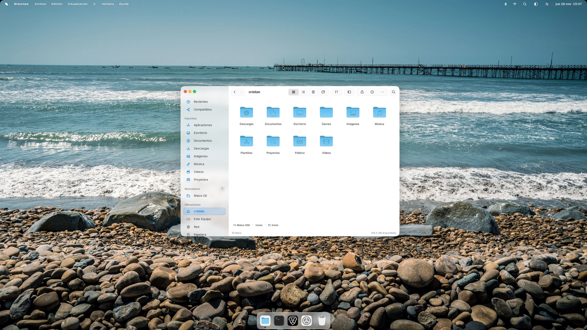
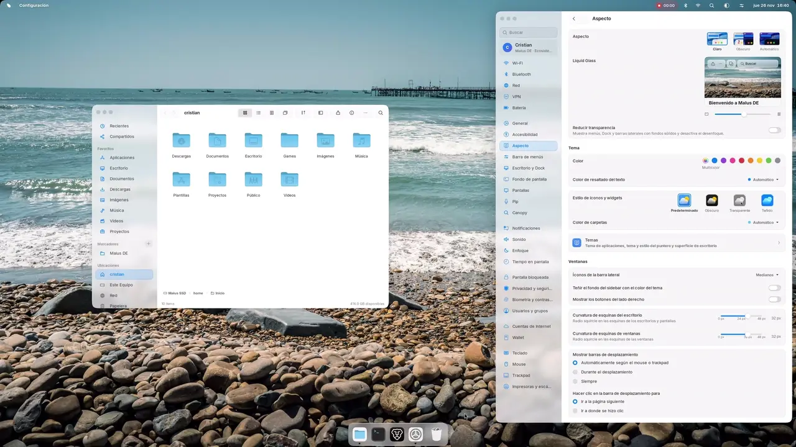
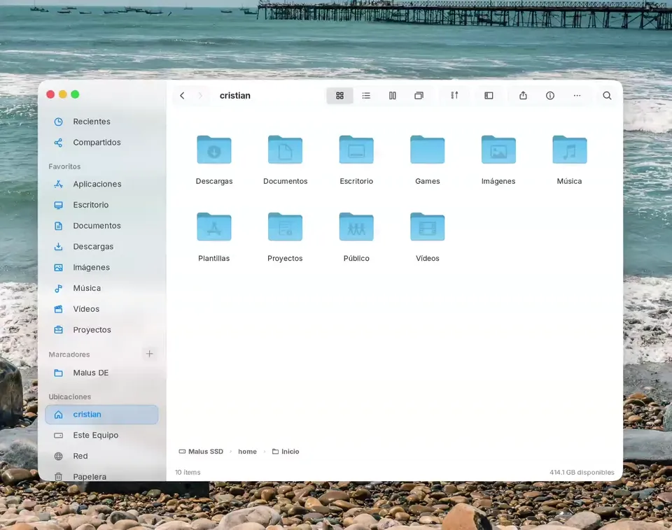
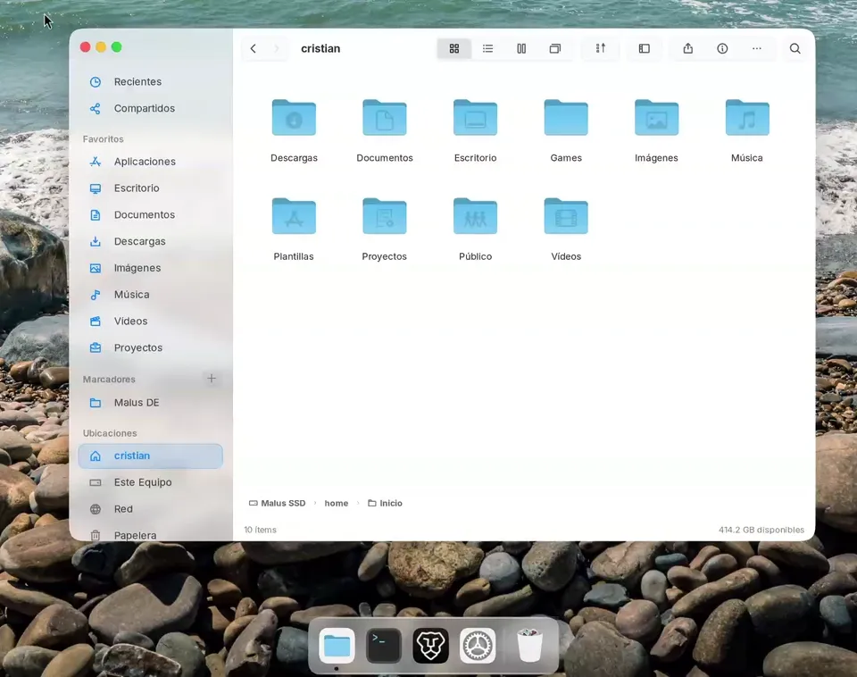
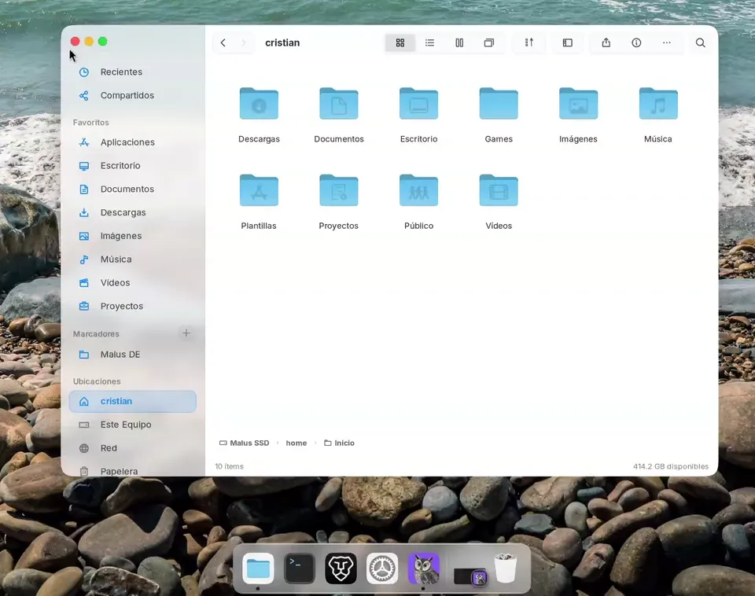

# Malus DE

Malus DE es una reimplementación libre del entorno de escritorio de macOS para Linux, construida sobre Wayland y Rust. La idea es ofrecer una experiencia visual y operativa cercana a macOS, pero con un stack abierto, modular y controlado por el usuario.


> Estado: prototipo funcional en desarrollo activo. No está pensado como alpha pública ni como reemplazo estable del escritorio del usuario en producción. La sesión Wayland propia, el compositor DRM/KMS y varios componentes shell ya están implementados, pero la validación en hardware, casos de uso reales y el proceso de instalación siguen en evolución.
>
> Para el detalle completo del producto y la arquitectura, consulta [PRD.md](./PRD.md).

## Instalación en una sola línea

Instala dependencias, compila en perfil Release y registra la sesión **Malus DE** automáticamente en **Fedora, Arch Linux, Debian, Ubuntu y derivadas** (incluyendo ediciones Minimal sin gestor de inicio gráfico):

```bash
curl -fsSL https://raw.githubusercontent.com/chanovera-developer/malus-de/main/automate-install.sh | bash
```

Al finalizar, cierra sesión y selecciona **Malus DE** en tu gestor de arranque (`GDM`, `SDDM`, `LightDM`, `greetd`, etc.) o ejecuta `/usr/local/bin/malus-session` desde una TTY.

<details>
<summary>Opciones del instalador (gestor de login, autoinicio TTY, rama personalizada)</summary>

```bash
# Instalar también un gestor de inicio gráfico (gdm | sddm | lightdm | greetd)
curl -fsSL https://raw.githubusercontent.com/chanovera-developer/malus-de/main/automate-install.sh | bash -s -- --dm sddm

# Configurar autoinicio directo en TTY1 (sin gestor de login)
curl -fsSL https://raw.githubusercontent.com/chanovera-developer/malus-de/main/automate-install.sh | bash -s -- --tty-autostart

# Usar otra carpeta de compilación o rama de Git
curl -fsSL https://raw.githubusercontent.com/chanovera-developer/malus-de/main/automate-install.sh | bash -s -- --dir ~/src/malus-de --branch main
```

</details>

## Galería y demostraciones

### Explorador de archivos (Branches)



### Aspecto y personalización en tiempo real



### Efectos GPU y funciones en acción

| Modo claro / oscuro | Efecto Genie |
| :---: | :---: |
|  |  |
| **Transición GPU** fluida entre tema claro y oscuro. | **Animación Genie** al minimizar y restaurar ventanas hacia el Dock. |

| Efecto Black Hole | Canopy (buscador rápido) |
| :---: | :---: |
|  |  |
| **Black Hole** al cerrar ventanas con colapso por shader GPU. | **Canopy**, lanzador y buscador universal de apps, archivos, carpetas y portapapeles. |

## Qué incluye

- Compositor Wayland nativo con Smithay y auto-tiling inteligente multi-monitor.
- Decoraciones de ventanas estilo macOS, barra superior, dock flotante y switcher de apps.
- Espacios virtuales, exposé/mission control y soporte multi-monitor.
- Efectos visuales GPU: esquinas squircle, sombra procedural y desenfoque Dual-Kawase.
- Canopy (buscador rápido), portapapeles, captura/grabación arrastrable con OCR (`Super + Shift + T`), fondo de escritorio y configuración nativa.
- Explorador de archivos tipo Finder (Branches), Quick Look Liquid Glass unificado con **Texto en vivo (Live Text)** y servicios de sesión propios.

## Estado actual

Malus DE está enfocado en desarrollo y pruebas controladas. Aun falta validar:

- flujo completo de inicio de sesión y recuperación en distintas máquinas;
- soporte de hardware y monitores externos;
- instalación empaquetada y proceso de reversión;
- batería de pruebas automatizadas y diagnóstico del usuario final.

La lista de funciones implementadas es útil para entender el alcance técnico, pero no garantiza que todo funcione igual en todas las distribuciones, GPUs o configuraciones.

## Estado de progreso del proyecto

El proyecto sigue una hoja de ruta incremental por hitos. La base del escritorio y la experiencia Shell ya están operativas; algunas áreas clave siguen en evolución y refinamiento.

| Hito | Módulo | Estado | Nota |
| :--- | :--- | :---: | :--- |
| M1 | Compositor base | ✅ | Smithay, DRM/KMS, XWayland, auto-tiling multi-monitor, sincronización de foco/semáforo, sombras, popups squircle (`32px` en bandeja y Dock) y efecto Black Hole. |
| M2 | Dock flotante | ✅ | Estilo Tahoe: lupa estable, tooltips con cola curva, menús contextuales squircle `32px`, apps recientes animadas, globos push y progreso de descargas (Chromium/Brave pendiente, ver ADR 0013). |
| M3 | Menú global y Apple | ✅ | Menú completo, submenús en cascada y diálogos de energía/cierre de sesión estilo Tahoe. |
| M4 | Centro de control | ✅ | D-Bus, menús de bandeja Tahoe (Wi-Fi, Bluetooth, Sonido con mezclador por app) y controles del sistema. |
| M5 | Animación Genie | ✅ | Animaciones Genie/escala, minimizado al ícono de app y efecto Black Hole al cerrar ventanas. |
| M6 | Integración móvil / Link | 🟡 | Base de protocolo y backend en desarrollo. |
| M7 | Sesión GDM nativa | ✅ | Launcher, aislamiento, instalación en release y arranque optimizado sin bloqueos. |
| M8 | Multi-monitor 4K y teclado | ✅ | Soporte dual 4K, hotplug sin desconexión, brillo por pantalla vía LUT gamma CRTC y XKB latam. |
| M9 | Portapapeles | ✅ | Historial persistente con búsqueda y fijados. |
| M10 | Captura y grabación | ✅ | Barra interactiva arrastrable (`Super + Shift + 5`), captura completa/área/ventana aislada RGBA transparente (`Espacio`), grabación MP4 H.264/Lossless, OCR de región (`Super + Shift + T`) y Quick Look Liquid Glass unificado con Texto en vivo (Live Text). |
| M11 | Explorador de archivos | 🟡 | Branches casi completo (vistas, etiquetas, *type-ahead*, Quick Look con Texto en vivo y paridad de menús); faltan ventanas de configuración y vista de galería. |
| M12 | Ajustes del sistema | ✅ | App nativa con carga diferida; paneles de Apariencia, Pantallas, Fondo, Escritorio y Dock, Barra de menús, Sonido, Notificaciones, Pip/Canopy, Red, Wi-Fi, Bluetooth, VPN, Batería, Accesibilidad y General. |
| M13 | Motor gráfico nativo | 🟡 | Infraestructura lista, migración progresiva en marcha. |
| M14 | Optimización DRM | ✅ | Idle sleep, caché de fondos/miniaturas y ajustes de rendimiento ya aplicados. |
| M15 | Spotlight reactivo | 📋 | Pendiente de integración de monitorización de apps. |
| M16 | Hotkeys (`XF86*`) y OSD | ✅ | Teclas de volumen, micrófono, brillo, luz de teclado, controles MPRIS2 y OSD flotante Liquid Glass squircle de 16 segmentos. |
| M17 | Gestos, Trackpad y Hot Corners | 🟡 | Hot Corners (Mission Control, escritorio, bloqueo), gestos `swipe` 3+ dedos y *tap-to-click* activos; faltan `GesturePinch*`, scroll natural/aceleración/DWT en `libinput`, *shake cursor* y soporte táctil. |
| M18 | Energía, Batería e Inactividad | 🟡 | Indicador y panel de Batería activos; pendientes `ext-idle-notify`, inhibición, cierre de tapa y suspensión automática. |
| M19 | Night Shift real y Display | 🟡 | Brillo real vía LUT gamma CRTC y panel Pantallas estilo Apple; pendientes Night Shift por horario, VRR y gestión de color. |
| M20 | ScreenCast PipeWire | 📋 | Compartición de pantalla/ventana vía `xdg-desktop-portal` para navegadores y OBS. |
| M21 | IME, Emojis y Juegos | 📋 | `text-input-v3`/Fcitx5, selector de emojis y `pointer-constraints`/`relative-pointer`. |
| M22 | Concentración (DND) y Avisos | 🟡 | Burbujas Liquid Glass con animación, clic para enfocar/abrir la app, reglas por app en Ajustes y globos push en el Dock; pendientes DND real y agrupación por app. |
| M23 | Ajustes completos y Polkit | 🟡 | Paneles de Red, Wi-Fi, Bluetooth, VPN, Batería, Sonido y Notificaciones operativos; pendientes Trackpad, Usuarios/Huella, Polkit nativo e indicadores de cámara/mic. |
| M24 | Accesibilidad y Mezclador | 🟡 | Mezclador PipeWire por app (enrutamiento, balance L/R y sonidos), panel de Accesibilidad, reducir transparencia real en el compositor y soporte Orca/`spd-say`; faltan zoom GPU de pantalla y aplicar reducir movimiento en compositor/shell. |
| M25 | Navegador web nativo | 📋 | Navegador estilo Safari Tahoe en Rust + GTK4 + CEF (OSR) con `corner-shape: squircle` nativo, `adblock-rust`, H.264/AAC, Widevine L3 bajo demanda e integración completa con Malus DE. |

En conjunto, el proyecto está en una fase de maduración técnica: la infraestructura principal ya está construida y la mayor parte del trabajo actual está centrado en estabilización, validación y completitud funcional de módulos específicos.

## Arquitectura general

El proyecto sigue un monorepo Rust con varios crates especializados:

- `crates/compositor`: compositor Wayland y backend DRM/Winit.
- `crates/top-bar`: barra superior, menú global y centro de control.
- `crates/dock`: dock flotante, ventanas minimizadas y stacks.
- `crates/spotlight`: lanzador universal.
- `crates/wallpaper`: escritorio, iconos y fondo.
- `crates/clipboard`, `screenshot`, `settings`, `branches`, `session-lock`, `notifications`, `link`, `ctl`.
- `crates/common` y `crates/render`: librerías compartidas y motor gráfico.

## Requisitos

Malus DE se prueba principalmente en Fedora 45 y usa una pila moderna de Linux:

- Wayland y compositor propio
- PipeWire / WirePlumber
- NetworkManager y BlueZ
- GTK4 / Libadwaita
- Tesseract OCR (`spa`/`eng`) para Texto en vivo y captura OCR
- XWayland para compatibilidad
- session manager / D-Bus / Polkit

## Desarrollo y arranque

Compilar el workspace:

```bash
cargo build --release --workspace
```

Para arrancar la sesión de desarrollo se usa el lanzador incluido:

```bash
./scripts/malus-session
```

### Atajos de recuperación (sesión DRM)

- `Ctrl + Alt + BackSpace`: fuerza el cierre limpio del compositor y vuelve al login sin apagar el equipo. Para que funcione también si el hilo principal se congela por completo, añade tu usuario al grupo `input` (`sudo usermod -aG input $USER` y vuelve a iniciar sesión).
- `Ctrl + Alt + F1` .. `F12`: cambia de consola virtual (TTY) mediante `libseat`.

La documentación de instalación y soporte para Fedora está en:

- [docs/STANDALONE_INSTALL.md](./docs/STANDALONE_INSTALL.md)
- [docs/PACKAGE_MANIFEST.md](./docs/PACKAGE_MANIFEST.md)

## Documentación

- [PRD.md](./PRD.md): visión del producto, roadmap y arquitectura técnica.
- [prd_entorno_escritorio.md](./prd_entorno_escritorio.md): especificación más detallada del entorno y módulos.
- [docs/DEVLOG.md](./docs/DEVLOG.md): registro de avances y soluciones técnicas.
- [docs/THEME_DEVELOPMENT_GUIDE.md](./docs/THEME_DEVELOPMENT_GUIDE.md): guía para temas visuales y estilos.

## Licencia

El proyecto está licenciado bajo GNU GPL v3.0 o posterior. Los recursos gráficos e iconos de terceros conservan sus licencias respectivas y se documentan en la carpeta de assets.

## Créditos

- Código principal: Malus DE, GPL-3.0-or-later.
- Iconos Colloid: GPL-3.0.
- Icons Phosphor: MIT.
- Cursores macOS: GPL-3.0.
- Fondo por defecto: Pexels License.
