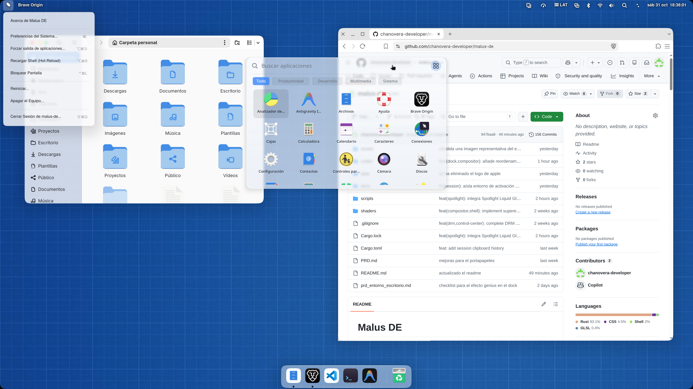

# Malus DE

**Malus DE** es una reimplementación libre del entorno de escritorio de macOS para Linux, construida sobre Wayland. Busca trasladar su estética y ergonomía a un sistema abierto y modular, con un compositor escrito en Rust y componentes de shell independientes.



> **Estado:** prototipo funcional en desarrollo activo; todavía no está listo para una alpha pública. Hay una sesión Wayland propia basada en Smithay, un backend DRM/KMS y componentes de shell utilizables, pero el funcionamiento integrado en distintas máquinas aún necesita validación. AirDrop/AWDL está en desarrollo. Consulta [PRD.md](./PRD.md) para el detalle de componentes y funciones pendientes.

> **Pruebas de plataforma:** Malus DE se está probando en Fedora 45.

### Estado de preparación para pruebas

Malus DE está pensado actualmente para desarrollo y pruebas controladas. Antes de invitar a un público abierto faltan, como mínimo:

- Dejar pasar toda la suite de pruebas automatizadas. En la revisión actual, `cargo test --workspace --no-fail-fast` pasa **al 100% sin fallos** en todos los crates del workspace (`malus-de-common`, `malus-de-compositor`, `malus-de-render`, `malus-de-top-bar`, `malus-de-dock`, `malus-de-spotlight`, `malus-de-wallpaper`, `malus-de-screenshot`).
- Validar el flujo completo de inicio de sesión, uso diario y recuperación en hardware y configuraciones de pantalla distintos.
- Proporcionar una instalación empaquetada y documentar una forma segura de desinstalar o revertir los cambios del instalador.
- Publicar instrucciones de diagnóstico y un canal claro para reportar fallos reproducibles.

Las funciones descritas abajo indican alcance implementado en el código, no una garantía de que todas se hayan verificado en cada distribución, GPU o configuración de monitores.

## Características

- Compositor Wayland basado en [Smithay](https://github.com/Smithay/smithay), con backend anidado Winit y backend DRM/KMS nativo.
- **Decoraciones de ventana del servidor (Server-Side Decorations / SSD) nativas estilo macOS:** Para aplicaciones que solicitan decoración del servidor mediante `zxdg_decoration_manager_v1` (como clientes Electron/Chromium, ZapFast, etc.), el compositor renderiza una barra de título nativa de `38 px` con los 3 botones semáforo a la izquierda (Cerrar, Minimizar con efecto Genie, Maximizar/Restaurar) con glifos vectoriales en hover, título centrado, arrastre fluido desde la barra, doble clic para maximizar, **redimensión perimetral interactiva desde los 8 bordes y esquinas** y **recorte squircle unificado ($n = 4.2$)** que abarca tanto la barra SSD como el cuerpo de la ventana.
- **Tema de cursores `macOS` integrado de serie (con respaldo infalible):** Incluye los temas `macOS` y `macOS-White` (`v2.0.1`) del proyecto [`apple_cursor`](https://github.com/ful1e5/apple_cursor) creado por **Abdulkaiz Khatri ([@ful1e5](https://github.com/ful1e5))** dentro del repositorio (`assets/cursors/`), instalándolos automáticamente en la sesión y embebiendo el cursor principal en el binario del compositor para que siempre se utilice el puntero de macOS en todos los casos, incluso ante errores de cursor o superficies de cliente inválidas.
- **Integración nativa de llavero (`org.freedesktop.secrets`):** Inicialización automática de `gnome-keyring-daemon --start --components=secrets,pkcs11,ssh` en la sesión de Malus DE para aplicaciones que requieren almacenamiento seguro de credenciales (ZapFast, clientes de mensajería, navegadores y editores).
- Prioridad de CPU adaptativa para aplicaciones Wayland nativas: crea scopes de systemd con `CPUWeight=1000` para la aplicación enfocada y `CPUWeight=20` para las que quedan en segundo plano. Los pesos son relativos; no reserva ni aísla núcleos.
- Shell modular con barra superior, menú global, centro de control, dock flotante, Spotlight, notificaciones y fondo de pantalla.
- Dock interactivo con animación de aumento/disminución, reorganización fluida de iconos por arrastre con huecos en tiempo real, desanclado con seguimiento 1:1 del cursor en el compositor y animación de nube de humo (*Poof*) radial estilo macOS al soltar fuera. Detección automática de iconos con fondo plano para extrapolación y curvatura continua squircle homogénea, así como contenedores automáticos para iconos con canal alfa.
- Spotlight Liquid Glass integrado en el compositor: barra de búsqueda con división fluida al pasar el cursor o desplegar resultados, esquinas squircle con desenfoque de fondo, localización automática al idioma de la sesión (`LC_MESSAGES`/`LANG`), indexación de aplicaciones nativas y Flatpak (incluyendo acciones de sesión para apagar, reiniciar o cerrar sesión) y arrastre directo de aplicaciones desde la lista de resultados hacia el Dock para anclarlas.
- Efecto Genie (Lámpara Mágica): minimización y restauración de ventanas hacia su icono en el Dock mediante una malla de deformación no lineal con continuidad suave $C^2$ (hasta 360 franjas horizontales) y recorte exacto de sombras CSD.
- Escritorio interactivo con iconos movibles, intercambio de archivos por arrastrar y soltar con el gestor de archivos y miniaturas de imágenes.
- Conmutador visual de ventanas (App Switcher) mediante `Alt + Tab` y `Super + Tab` para recorrer y alternar fluidamente entre aplicaciones y ventanas abiertas.
- Integración con servicios de Linux para audio, red, Bluetooth y controles multimedia.
- **Barra interactiva de captura y grabación de pantalla (`Super + Shift + 5` / `Super + Impr Pant`):** Renderizada directamente en el compositor con estética Liquid Glass, permite elegir entre captura de pantalla completa, ventana enfocada o selección de área, así como grabación de vídeo de pantalla completa o de región en MP4 (`H.264`), con opciones de temporizador (ninguno, 5 s, 10 s), destino (Archivo o Portapapeles) e inclusión del cursor. Además mantiene los atajos directos (`Super + Shift + 3` y `Super + Shift + 4`), alerta auditiva inmediata, destello blanco suave estilo macOS, miniatura flotante interactiva y copia con `wl-copy`.
- Historial local persistente de hasta 50 elementos de texto, imágenes, documentos y URI de archivos, accesible con `Super + V`. Admite búsqueda, fijar elementos, volver a copiarlos y borrarlos; ocupa como máximo 50 MiB (10 MiB por elemento). La sincronización con la selección primaria de Wayland es opcional y está desactivada por defecto. El filtro automático de credenciales está activado por defecto y se puede configurar desde la interfaz; es heurístico y no detecta todos los secretos. Los datos se guardan localmente con permisos privados, se conservan entre sesiones y se eliminan al borrar el historial. Requiere `wl-clipboard`.
- Efectos gráficos con shaders GLSL, esquinas squircle y animaciones fluidas de ventanas.
- Detección de pantallas y modos compatibles por DRM/KMS, con resolución, disposición y escala fraccionaria configurables en caliente.
- Experimentos de integración con dispositivos Apple mediante AirDrop; el backend AWDL/BLE está en desarrollo.

## Arquitectura

El proyecto es un workspace de Rust. Sus componentes principales viven en `crates/`:

| Componente | Paquete |
| --- | --- |
| Compositor Wayland | `malus-de-compositor` |
| Barra superior y centro de control | `malus-de-top-bar` |
| Dock | `malus-de-dock` |
| Lanzador Spotlight | `malus-de-spotlight` |
| Explorador de archivos (Branches) | `malus-de-branches` |
| Notificaciones | `malus-de-notifications` |
| Fondo de pantalla | `malus-de-wallpaper` |
| Ajustes | `malus-de-settings` |
| Servicios comunes | `malus-de-common` |
| Bloqueo de sesión, captura, portapapeles, enlace y CLI | `malus-de-session-lock`, `malus-de-screenshot`, `malus-de-clipboard`, `malus-de-link`, `malus-de-ctl` |

## Requisitos

- Linux con soporte para Wayland.
- Rust y Cargo (edición 2021).
- Bibliotecas de desarrollo de GTK4, libadwaita, gtk4-layer-shell, Mesa/GBM, libinput, libseat, systemd, libxkbcommon y D-Bus.
- Servicios y utilidades de sesión para que Malus DE funcione de forma completa:
  - **Audio y multimedia:** `pipewire`, `pipewire-pulseaudio`, `pipewire-utils` (`pw-play`), `wireplumber`, `libcanberra-gtk3` y `ffmpeg` (para grabación de pantalla en MP4).
  - **Seguridad, permisos y llavero (`org.freedesktop.secrets`):** `polkit`, `mate-polkit` (agente de autenticación gráfica para instalación de apps y permisos de administrador), `gnome-keyring`, `gnome-keyring-pam` y `libsecret`.
  - **Portales, portapapeles y montaje de medios:** `xdg-desktop-portal`, `xdg-desktop-portal-gnome`, `xdg-desktop-portal-gtk`, `wl-clipboard` (`wl-copy` / `wl-paste`), `gvfs` y `udisks2`.
  - **Conectividad y energía:** `NetworkManager`, `bluez`, `power-profiles-daemon`.
  - **Compatibilidad de clientes:** `qt5-qtwayland`, `qt6-qtwayland` y `xorg-x11-server-Xwayland`.

La lista detallada de paquetes por distribución está en el [manifiesto de dependencias](./docs/PACKAGE_MANIFEST.md). Los componentes y requisitos de producto se describen en el [PRD](./PRD.md) y el avance cronológico en el [registro de desarrollo (DEVLOG)](./docs/DEVLOG.md).

## Compilar y Dependencias en Fedora

En Fedora, instala las herramientas de compilación y los paquetes de ejecución necesarios:

```bash
sudo dnf install -y \
    rust \
    rustfmt \
    cargo \
    gcc \
    clang \
    pkgconf-pkg-config \
    gtk4-devel \
    libadwaita-devel \
    gtk4-layer-shell-devel \
    mesa-libgbm-devel \
    libinput-devel \
    libseat-devel \
    systemd-devel \
    dbus-devel \
    libxkbcommon-devel \
    polkit \
    mate-polkit \
    gnome-keyring \
    gnome-keyring-pam \
    libsecret \
    xdg-desktop-portal \
    xdg-desktop-portal-gtk \
    xdg-desktop-portal-gnome \
    wl-clipboard \
    pipewire-utils \
    libcanberra-gtk3 \
    ffmpeg-free \
    gvfs \
    udisks2 \
    qt5-qtwayland \
    qt6-qtwayland \
    xorg-x11-server-Xwayland
```

`systemd-devel` proporciona los archivos de desarrollo de `libudev`; `libxkbcommon-devel` es necesario para enlazar el compositor. Asegúrate también de tener Rust y Cargo instalados (edición 2021).

Clona el repositorio y compila desde su raíz:

```bash
git clone https://github.com/chanovera-dev/malus-de.git
cd malus-de
cargo build --workspace
```

Para otras distribuciones, consulta los paquetes equivalentes en el [manifiesto de dependencias](./docs/PACKAGE_MANIFEST.md).

Para compilar en modo optimizado:

```bash
cargo build --workspace --release
```

## Capturas y Grabación de Pantalla

La suite de captura y grabación de Malus DE (`malus-de-screenshot`) está integrada directamente en el núcleo del compositor Wayland y el protocolo `Layer Shell`, garantizando capturas de máxima fidelidad gráfica sin intermediarios ni dependencias de portales externos.

### Atajos de teclado estilo macOS

| Atajo | Acción | Descripción |
| :--- | :--- | :--- |
| `Super + Shift + 5` / `Super + Impr Pant` | **Barra interactiva** | Despliega la barra flotante estilo macOS para alternar modos, temporizador y destino. |
| `Super + Shift + 3` / `Impr Pant` | **Pantalla completa** | Captura inmediata de todas las pantallas conectadas. |
| `Super + Shift + 4` / `Shift + Impr Pant` / `Super + Shift + S` | **Selección de área** | Capa interactiva de recorte con oscurecimiento, retícula de precisión y ajuste de esquinas. |

### Características principales

- **Barra interactiva de captura y grabación:**
  - Selector visual de **Captura Completa**, **Captura de Área** y **Grabación de Pantalla** en formato `.webm`.
  - Configuración de temporizador con cuenta regresiva flotante (desactivado, 5 s, 10 s).
  - Selector de destino (guardar archivo en carpeta de usuario o copiar directamente al portapapeles).
  - Opción para incluir u ocultar el puntero del cursor en el fotograma.
- **Feedback audiovisual auténtico:**
  - **Sonido de obturador instantáneo:** Reproducción prioritaria del sonido nativo (`screen-capture.oga` / `camera-shutter.oga`) mediante PipeWire (`pw-play`) con latencia casi cero, y respaldo automático a `canberra-gtk-play` y `paplay`.
  - **Destello visual suave (*Flash*):** Animación de destello blanco puro en capa `Layer::Overlay` sobre todas las salidas, desvaneciéndose fluidamente en 200 ms.
- **Miniatura flotante interactiva (*Floating Thumbnail*):**
  - Al completar la captura, se presenta una miniatura flotante en la esquina inferior derecha con vista previa de alta resolución.
  - Ofrece botones de acción rápida para volver a copiar la imagen al portapapeles o descartar el archivo, cerrándose automáticamente tras 6 segundos de inactividad.
- **Grabación de pantalla con indicador en vivo:**
  - Indicador flotante en la barra superior con contador cronométrico y botón de parada rápida (`● 00:00 [⏹ Detener]`).
  - Almacena automáticamente los vídeos generados en `~/Vídeos/Grabaciones de pantalla/`.
- **Destino y compatibilidad de archivos:**
  - Las capturas se guardan en formato PNG de compresión óptima en `~/Imágenes/Capturas de pantalla/` (respetando carpetas de usuario XDG) y se copian en paralelo al portapapeles del sistema mediante `wl-copy`.

### Comandos CLI de captura

```bash
# Lanzar la barra interactiva de opciones (estilo macOS)
malus-de-screenshot

# Captura inmediata de pantalla completa
malus-de-screenshot --mode full

# Selección interactiva de área
malus-de-screenshot --mode area

# Grabación de pantalla directa
malus-de-screenshot --mode record

# Copiar exclusivamente al portapapeles (sin guardar archivo ni mostrar miniatura)
malus-de-screenshot --mode full --clipboard-only

# Captura con cuenta regresiva de 5 segundos
malus-de-screenshot --mode area --delay 5
```

> **Alcance y dependencias:** Requiere `wl-clipboard` (`wl-copy`) para portapapeles, `pipewire-utils` (`pw-play`) para sonido de obturador y `ffmpeg` (`ffmpeg-free`) para codificación de vídeo. La captura aislada de ventana individual y la extracción de texto mediante OCR continúan en desarrollo activo.

## Gestor de Portapapeles (Super + V)

El gestor de portapapeles integrado (`malus-de-clipboard`) opera en segundo plano conectado a las extensiones de portapapeles de Wayland (`wlr-data-control`):

- **Capacidad e historial:** Conserva hasta 50 elementos (texto sin formato, enlaces, URIs de archivos, imágenes y documentos PDF/RTF) con un límite de 10 MiB por elemento y un tope global de 50 MiB.
- **Acceso rápido y búsqueda:** Pulsa `Super + V` para abrir la interfaz flotante donde podrás buscar en tiempo real, anclar/fijar elementos prioritarios en la parte superior, volver a copiar al portapapeles o eliminarlos individualmente o en lote.
- **Privacidad y filtro sensible:** Incluye un filtro heurístico configurable activado por defecto que ignora selecciones marcadas como contraseñas por los clientes (gestores de contraseñas, campos protegidos) y omite patrones comunes de claves privadas o credenciales. El historial se almacena en el disco con permisos restrictivos privados (`0600`) dentro de `$HOME/.config/malus-de/clipboard/`.

## Gestión de Pantallas 4K y Escalado (TrueSize)

En **Ajustes del Sistema → Pantallas**, cada monitor conectado muestra sus modos DRM/KMS nativos:

- Permite seleccionar resoluciones independientes (por ejemplo, `3840 × 2160` y `1920 × 1080`) y aplicar escalado fraccionario independiente en vivo sin necesidad de reiniciar la sesión gráfica.
- **Enlace Físico 1:1 (`TrueSize Link`):** Vincula matemáticamente las pantallas contiguas según su densidad real de píxeles por pulgada (`PPI`), de modo que el cursor y las ventanas mantengan su tamaño físico continuo al cruzar de un monitor a otro sin saltos o desfases geométricos.
- **Resiliencia KMS:** Si el controlador de gráficos rechaza un modo guardado durante el arranque en frío, el compositor realiza un sondeo fallback automático entre los modos anunciados por la pantalla y activa el modo más óptimo compatible.

## Instalación de la sesión

El script [install-session.sh](./scripts/install-session.sh) compila los binarios e instala la sesión de Malus DE para GDM en el sistema. Es una instalación manual para desarrollo y pruebas, no un instalador empaquetado para distribución: requiere privilegios de administrador y modifica rutas del sistema, incluidas preferencias globales de `xdg-desktop-portal`. **No hay un desinstalador automático documentado.** Revisa el script, confirma las dependencias de tu distribución y prepara una forma de revertir los cambios antes de ejecutarlo:

```bash
sudo ./scripts/install-session.sh
```

La instalación no modifica los archivos ni las preferencias de VS Code, Antigravity, Firefox o Brave. Malus usa `~/.config/malus-de` como `XDG_CONFIG_HOME` y el backend `keyfile` de GSettings; sus ajustes GTK y el diseño de los botones quedan separados de GNOME. Por defecto, las aplicaciones GTK/Libadwaita que respetan la configuración de la sesión muestran los controles estilo macOS a la izquierda. La personalización de su posición se añadirá más adelante; por ahora Malus mantiene ese diseño. Las aplicaciones que dibujan sus propios controles pueden ignorar el estilo GTK. El lanzador solo propaga al entorno de activación compartido las variables necesarias para el display: no exporta allí `XDG_CONFIG_HOME`, `GSETTINGS_BACKEND` ni `GTK_USE_PORTAL`, para que los servicios de GNOME no hereden la configuración de Malus.

Nautilus puede mostrar las carpetas personales XDG del usuario en Lugares; estas se determinan mediante `~/.config/user-dirs.dirs`, no mediante los marcadores. El lanzador copia ese archivo y los marcadores GTK a la configuración aislada de Malus si aún no existen. Cierra cualquier otra sesión GNOME para evitar que Nautilus reutilice una instancia abierta. Tras actualizar desde una versión que propagaba todo el entorno a D-Bus/systemd, cierra por completo las sesiones gráficas y vuelve a entrar para que los servicios activados con el entorno anterior se reinicien.

El lanzador crea las carpetas personales XDG estándar si faltan y añade sus ubicaciones como marcadores GTK. Estos marcadores son accesos adicionales y se administran por separado de las carpetas que Nautilus muestra en Lugares. Malus también comparte el bus D-Bus de la sesión para que los navegadores y otras aplicaciones puedan comunicarse con xdg-desktop-portal.

La [guía de manifiesto](./docs/PACKAGE_MANIFEST.md) documenta dependencias de ejecución, compilación y servicios que deben habilitarse.
Los selectores de archivos de GTK y aplicaciones compatibles (por ejemplo, VS Code) usan xdg-desktop-portal. Malus prefiere el backend GNOME para estos diálogos, con GTK como alternativa; instala ambos backends.

> **Flujo de desarrollo rápido:** El script lanzador de sesión (`malus-session`) prioriza automáticamente los binarios recién compilados en `$HOME/Proyectos/malus-de/target/release/`. Por lo tanto, durante el desarrollo diario no necesitas volver a ejecutar `install-session.sh` para probar cambios de código: basta con compilar con `cargo build --release` y reiniciar la sesión gráfica. Solo es necesario reejecutar el instalador si se modifican archivos del sistema (iconos, fondos SVG compartidos, targets de systemd, configuraciones de portal o el archivo `.desktop` de GDM).

El menú global solo puede mostrar y ejecutar menús que la aplicación publique mediante `com.canonical.dbusmenu` y `com.canonical.AppMenu.Registrar`. Malus no inventa menús aproximados para aplicaciones que no los publican; algunas aplicaciones Electron, incluida VS Code según su versión y configuración, pueden no exponerlos en Linux.

## Limitaciones conocidas y alcance pendiente

- **Indexación dinámica de aplicaciones en Spotlight:** El indexador de aplicaciones de Spotlight (`malus-de-spotlight`) lee los directorios `.desktop` al inicializarse la sesión. Si se instala o desinstala una aplicación durante la sesión activa (por ejemplo, mediante la app Software o DNF), se requiere reiniciar la sesión para que aparezca en los resultados de búsqueda. El monitoreo dinámico de directorios en tiempo real mediante `inotify` está pendiente de implementación.
- Los menús emergentes y desplegables (`xdg_popup`) en navegadores tienen incidencias pendientes en depuración (desfase de coordenadas en desplegables `<select>` de Firefox y visualización de menús contextuales/hamburguesa en Brave Browser bajo Ozone/Wayland).
- AirDrop/AWDL y la integración BLE están en desarrollo; no se debe considerar disponible el intercambio completo con dispositivos Apple.
- El OCR en capturas de pantalla aún no está implementado.
- El menú global depende de que cada aplicación publique los protocolos `com.canonical.dbusmenu` y `com.canonical.AppMenu.Registrar`; no todas las aplicaciones lo hacen.
- La instalación modifica configuración global del portal y no dispone de un proceso automático de desinstalación o reversión.

Si pruebas Malus, incluye en el reporte la distribución y versión, GPU y controlador, número y modos de pantalla, backend utilizado (DRM o Winit), pasos para reproducir el problema y los registros de `~/.local/share/malus-de/session.log` cuando estén disponibles. No compartas registros que contengan información personal sin revisarlos primero.

## Documentación

- [PRD y arquitectura técnica](./PRD.md)
- [Registro de desarrollo (DEVLOG)](./docs/DEVLOG.md)
- [Manifiesto de dependencias y paquetes](./docs/PACKAGE_MANIFEST.md)
- [Guía de desarrollo de temas](./docs/THEME_DEVELOPMENT_GUIDE.md)

## Créditos y Licencias

- **Código fuente de Malus DE:** El workspace declara las licencias **MIT OR Apache-2.0** en `Cargo.toml`.
- **Tema de cursores `macOS` y `macOS-White` (`assets/cursors/`):** Basado en [`apple_cursor` (v2.0.1)](https://github.com/ful1e5/apple_cursor), creado y mantenido por **Abdulkaiz Khatri ([@ful1e5](https://github.com/ful1e5))**, distribuido bajo la licencia **GNU General Public License v3.0 (GPL-3.0)** (ver [`assets/cursors/LICENSE`](./assets/cursors/LICENSE)).
