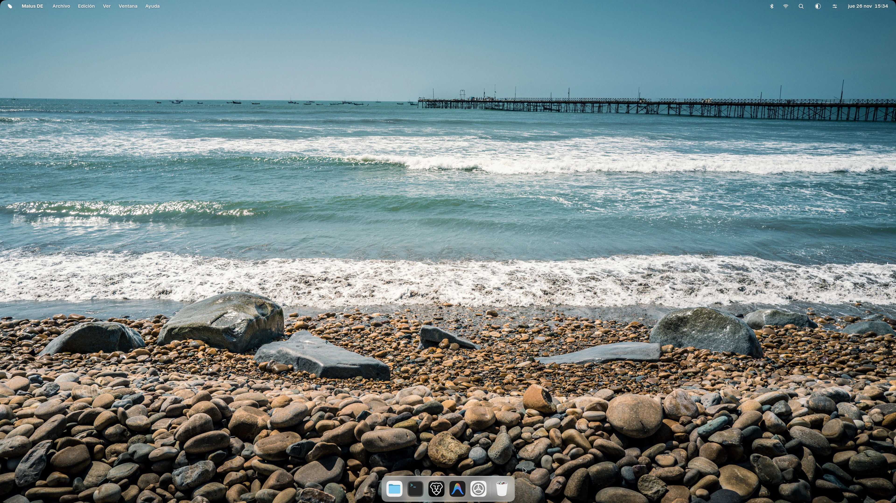

# Malus DE

Malus DE es una reimplementación libre del entorno de escritorio de macOS para Linux, construida sobre Wayland y Rust. La idea es ofrecer una experiencia visual y operativa cercana a macOS, pero con un stack abierto, modular y controlado por el usuario.



> Estado: prototipo funcional en desarrollo activo. No está pensado como alpha pública ni como reemplazo estable del escritorio del usuario en producción. La sesión Wayland propia, el compositor DRM/KMS y varios componentes shell ya están implementados, pero la validación en hardware, casos de uso reales y el proceso de instalación siguen en evolución.
>
> Para el detalle completo del producto y la arquitectura, consulta [PRD.md](./PRD.md).

## Qué incluye

- Compositor Wayland nativo con Smithay.
- Decoraciones de ventanas estilo macOS, barra superior, dock flotante y switcher de apps.
- Espacios virtuales, exposé/mission control y soporte multi-monitor.
- Efectos visuales GPU: esquinas squircle, sombra procedural y desenfoque Dual-Kawase.
- Spotlight, portapapeles, captura de pantalla, fondo de escritorio y configuración nativa.
- Explorador de archivos tipo Finder y servicios de sesión propios.

## Estado actual

Malus DE está enfocado en desarrollo y pruebas controladas. Aun falta validar:

- flujo completo de inicio de sesión y recuperación en distintas máquinas;
- soporte de hardware y monitores externos;
- instalación empaquetada y proceso de reversión;
- batería de pruebas automatizadas y diagnóstico del usuario final.

La lista de funciones implementadas es útil para entender el alcance técnico, pero no garantiza que todo funcione igual en todas las distribuciones, GPUs o configuraciones.

## Arquitectura general

El proyecto sigue un monorepo Rust con varios crates especializados:

- `crates/compositor`: compositor Wayland y backend DRM/Winit.
- `crates/top-bar`: barra superior, menú global y centro de control.
- `crates/dock`: dock flotante, ventanas minimizadas y stacks.
- `crates/spotlight`: lanzador universal.
- `crates/wallpaper`: escritorio, iconos y fondo.
- `crates/clipboard`, `screenshot`, `settings`, `branches`, `session-lock`, `notifications`, `link`, `ctl`.
- `crates/common` y `crates/render`: librerías compartidas y motor gráfico.

## Requisitos

Malus DE se prueba principalmente en Fedora 45 y usa una pila moderna de Linux:

- Wayland y compositor propio
- PipeWire / WirePlumber
- NetworkManager y BlueZ
- GTK4 / Libadwaita
- XWayland para compatibilidad
- session manager / D-Bus / Polkit

## Desarrollo y arranque

Compilar el workspace:

```bash
cargo build --release --workspace
```

Para arrancar la sesión de desarrollo se usa el lanzador incluido:

```bash
./scripts/malus-session
```

La documentación de instalación y soporte para Fedora está en:

- [docs/FEDORA_STANDALONE_INSTALL.md](./docs/FEDORA_STANDALONE_INSTALL.md)
- [docs/PACKAGE_MANIFEST.md](./docs/PACKAGE_MANIFEST.md)

## Documentación

- [PRD.md](./PRD.md): visión del producto, roadmap y arquitectura técnica.
- [prd_entorno_escritorio.md](./prd_entorno_escritorio.md): especificación más detallada del entorno y módulos.
- [docs/DEVLOG.md](./docs/DEVLOG.md): registro de avances y soluciones técnicas.
- [docs/THEME_DEVELOPMENT_GUIDE.md](./docs/THEME_DEVELOPMENT_GUIDE.md): guía para temas visuales y estilos.

## Licencia

El proyecto está licenciado bajo GNU GPL v3.0 o posterior. Los recursos gráficos e iconos de terceros conservan sus licencias respectivas y se documentan en la carpeta de assets.

## Créditos

- Código principal: Malus DE, GPL-3.0-or-later.
- Iconos Colloid: GPL-3.0.
- Icons Phosphor: MIT.
- Cursores macOS: GPL-3.0.
- Fondo por defecto: Pexels License.
