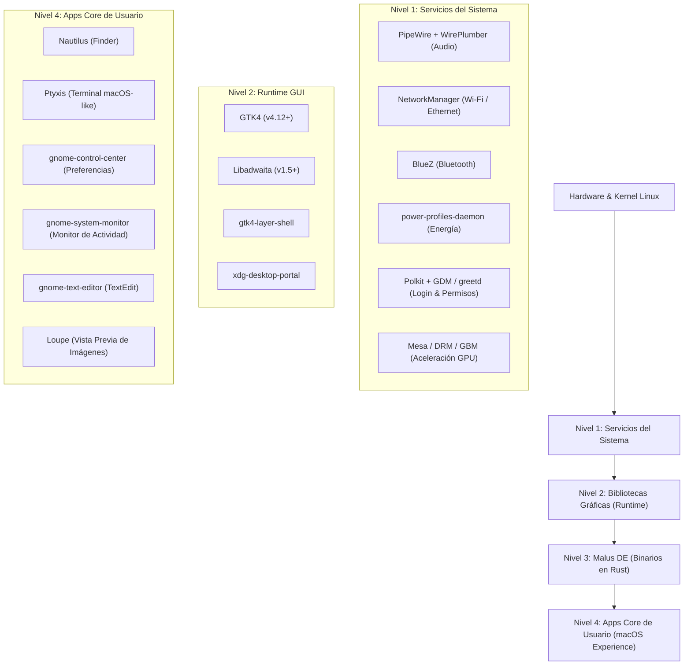

# Manifiesto de Dependencias y Paquetes de Malus DE

Este documento detalla la lista exacta de paquetes requeridos para construir una distribución independiente de Malus DE partiendo de una instalación mínima sin entorno gráfico (como *Fedora Everything/Minimal*, *Debian Minimal*, *Ubuntu Server/Core* o *Arch Linux*).

La sesión fuerza a GTK a usar xdg-desktop-portal y prefiere el selector de archivos del backend GNOME, con GTK como alternativa. Instala `xdg-desktop-portal`, `xdg-desktop-portal-gtk` y `xdg-desktop-portal-gnome`.

---

## 1. Arquitectura de Paquetes

Malus DE divide sus requerimientos en tres categorías esenciales:



---

## 2. Manifiesto para Fedora / Red Hat (`dnf`)

Para una imagen limpia construida sobre **Fedora Minimal / Everything**:

### A. Runtime para Usuario Final (Ejecutar Malus DE)
```bash
sudo dnf install -y \
    mesa-dri-drivers \
    mesa-vulkan-drivers \
    pipewire \
    pipewire-pulseaudio \
    wireplumber \
    NetworkManager \
    NetworkManager-wifi \
    bluez \
    bluez-tools \
    power-profiles-daemon \
    polkit \
    gdm \
    gtk4 \
    libadwaita \
    gtk4-layer-shell \
    xdg-desktop-portal \
    xdg-desktop-portal-gtk \
    xdg-desktop-portal-gnome \
    nautilus \
    ptyxis \
    gnome-control-center \
    gnome-system-monitor \
    gnome-text-editor \
    loupe \
    inter-fonts
```

### B. Dependencias de Compilación (`dnf` para desarrolladores)
```bash
sudo dnf install -y \
    gcc \
    clang \
    pkg-config \
    gtk4-devel \
    libadwaita-devel \
    gtk4-layer-shell-devel \
    mesa-libgbm-devel \
    libinput-devel \
    libseat-devel \
    libxkbcommon-devel \
    systemd-devel \
    dbus-devel
```

---

## 3. Manifiesto para Debian / Ubuntu (`apt`)

Para una imagen construida sobre **Debian Minimal / Ubuntu Server**:

### A. Runtime para Usuario Final
```bash
sudo apt install -y \
    mesa-va-drivers \
    mesa-vulkan-drivers \
    pipewire \
    pipewire-pulse \
    wireplumber \
    network-manager \
    bluez \
    bluez-tools \
    power-profiles-daemon \
    policykit-1 \
    gdm3 \
    libgtk-4-1 \
    libadwaita-1-0 \
    libgtk4-layer-shell0 \
    xdg-desktop-portal \
    xdg-desktop-portal-gtk \
    xdg-desktop-portal-gnome \
    nautilus \
    ptyxis \
    gnome-control-center \
    gnome-system-monitor \
    gnome-text-editor \
    loupe \
    fonts-inter
```

### B. Dependencias de Compilación (`apt` para desarrolladores)
```bash
sudo apt install -y \
    build-essential \
    clang \
    pkg-config \
    libgtk-4-dev \
    libadwaita-1-dev \
    libgtk4-layer-shell-dev \
    libgbm-dev \
    libinput-dev \
    libseat-dev \
    libsystemd-dev \
    libdbus-1-dev
```

---

## 4. Manifiesto para Arch Linux (`pacman`)

### A. Runtime para Usuario Final
```bash
sudo pacman -S --needed \
    mesa \
    vulkan-radeon \
    pipewire \
    pipewire-pulse \
    wireplumber \
    networkmanager \
    bluez \
    bluez-utils \
    power-profiles-daemon \
    polkit \
    gdm \
    gtk4 \
    libadwaita \
    gtk4-layer-shell \
    xdg-desktop-portal \
    xdg-desktop-portal-gtk \
    xdg-desktop-portal-gnome \
    nautilus \
    ptyxis \
    gnome-control-center \
    gnome-system-monitor \
    gnome-text-editor \
    loupe \
    inter-font
```

---

## 5. Servicios Systemd que deben habilitarse al instalar la Distro

En los scripts de instalación de la ISO (Kickstart, Calamares o script post-install):

```bash
sudo systemctl enable gdm.service
sudo systemctl enable NetworkManager.service
sudo systemctl enable bluetooth.service
sudo systemctl enable power-profiles-daemon.service
```
