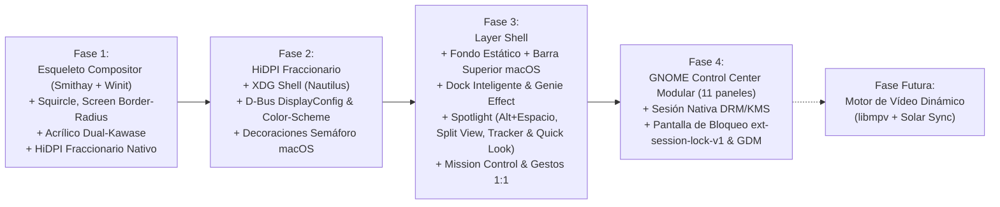

# PRD & Arquitectura Técnica: Entorno de Escritorio Wayland

**Estado:** Borrador Revisado  
**Fecha:** Septiembre 2026  
**Stack Principal:** Rust, Smithay, Wayland Protocols, GLSL Shaders (libmpv / VA-API diferido para fase posterior)  

---

## 1. Visión del Producto

> [!IMPORTANT]
> **Filosofía y Manifiesto Arquitectónico:**  
> Este proyecto **NO es una extensión ni adaptación de `gnome-shell`**, evitando la fragilidad de scripts en JavaScript, fugas de memoria y limitaciones de Mutter. Se trata de un **entorno de escritorio autónomo y ultraligero compilado en Rust nativo sobre Smithay**, que aprovecha estratégicamente las tecnologías más robustas del ecosistema GNOME (GTK4, Libadwaita, Nautilus, indexación semántica Tracker Miner FS, demonios de sistema) y las fusiona con la elegancia visual, ergonomía y fluidez de macOS (Barra Superior transparente con Global Menu, Dock acrílico con Genie Effect y Lanzador Universal Spotlight con Quick Look).

Crear un entorno de escritorio moderno, minimalista, ultra seguro y eficiente en recursos para Linux, caracterizado por:
1. **Identidad visual fluida y bordes redondeados globales:** 
   * **Bordes redondeados de pantalla (`Screen Border-Radius`):** El compositor aplica un efecto en el viewport/salida del monitor para simular que la pantalla física posee esquinas redondeadas orgánicas (estilo bisel curvo de hardware moderno).
   * **Superficies Squircle:** Ventanas y menús con curvatura continua (superelipses tipo $n \approx 4.2$) con antialiasing analítico subpíxel.
   * **Controles de Ventana Flexibles (Botones Semáforo macOS):**
     * Soporte nativo para posicionar los controles de ventana (*Cerrar, Minimizar, Maximizar*) tanto a la izquierda como a la derecha.
     * En el **lado izquierdo**, se adopta estrictamente la distribución y ergonomía de **macOS: `[Cerrar, Minimizar, Maximizar]`** (estilo semáforo rojo, amarillo y verde, con revelado de glifos interactivos al hacer *hover*).
     * En el **lado derecho**, adopta la distribución estándar tradicional: `[Minimizar, Maximizar, Cerrar]`.
2. **Material Acrílico y Desenfoque por GPU (Dual-Kawase Blur):**
   * **Fondos Claros / Blancos con Efecto Acrílico:** Las superficies claras no son blanco plano, sino blanco translúcido con desenfoque de fondo profundo estilo *Frosted Glass* / *Acrylic*.
   * **Tema Oscuro Nativo (*Dark Acrylic / Smoked Glass*):** Modo oscuro integral con tintes grafito/carbón translúcidos y desenfoque, sincronizado con el estándar de escritorio `org.freedesktop.appearance.color-scheme`.
   * **Barra Superior Siempre Transparente:** La barra superior se mantiene permanentemente translúcida/acrílica, adaptando sus contrastes según el tema activo.
   * **Modo Rendimiento / Bajo Consumo (Toggle en Panel de Control):** Posibilidad de desactivar el desenfoque y las transparencias en caliente desde los ajustes; el compositor conmuta al instante a fondos sólidos (blanco o gris oscuro) sin costo de shaders FBO, preservando intactos los bordes redondeados.
3. **HiDPI y Escalado Fraccionario Nativo desde el Inicio:**
   * Soporte prioritario desde la Fase 1 para `wp_fractional_scale_manager_v1` y `wp_viewporter`.
   * Renderizado nativo al píxel para factores de escala fraccionarios (ej. 125%, 150%, 175%) sin el desenfoque habitual de reescalado simple por GPU.
4. **Superficie de Escritorio Activa con Iconos y Pilas (*macOS Stacks*):** 
   * **Archivos Nativos en el Escritorio:** Soporte directo y fluido para interactuar con la carpeta `~/Escritorio` en la pantalla (abrir, mover, renombrar) sin requerir extensiones externas inestables como en GNOME Shell.
   * **Pilas en el Escritorio (*macOS Stacks*):** Agrupación automática de archivos dispersos en montones categorizados (*Fotos*, *Documentos*, *Capturas*), desplegables en abanico con un clic.
   * **Interacción Rápida:** Selección elástica rectangular (*marquee*), atajo universal de **Quick Look (`Espacio`)** para previsualización inmediata y Drag & Drop Wayland hacia Nautilus, el Dock o apps externas.
   * *(El motor de vídeo dinámico con sincronización solar queda planificado para una fase posterior).*
5. **Integración profunda con el ecosistema GNOME y Configuración Modular:**
   * Compatibilidad nativa con aplicaciones esenciales como **Nautilus** (Archivos).
   * Adopción modular de **GNOME Control Center (`gnome-control-center`)** filtrado exclusivamente con las 11 secciones esenciales solicitadas, enlazando el panel de Pantallas directamente con el backend de escalado del compositor.
6. **Dock Inteligente Estilo macOS con Diseño Totalmente Personalizable:**
   * **Diseño y Geometría Flexibles:** Configuración de anclaje (Inferior, Izquierda o Derecha), selector de estilo entre **Cápsula Flotante (*Floating Pill*)** o **Panel Extendido (*Edge-to-Edge Bar*)**, ajuste granular de opacidad (0-100%), radio de curvatura squircle, intensidad de desenfoque GPU Dual-Kawase, estilo de indicadores activos (punto, barra, halo) y hojas de estilo CSS con recarga en caliente.
   * **Magnificación Analítica Configurable:** Efecto de zoom suave (*Gaussian curve*) totalmente personalizable (posibilidad de apagar el zoom o calibrar su escala máxima de 48px a 128px).
   * **Efecto Lámpara de Aladino (*Genie Effect*):** Deformación fluida no lineal acelerada por shaders GLSL en el compositor al minimizar y restaurar ventanas.
   * **Miniaturas de Ventanas Minimizadas:** Al minimizar una ventana, se genera una miniatura viva/estática nítida alojada en la sección derecha del Dock.
   * **Organización Integral de Contenidos:** Separador vertical que divide las aplicaciones ancladas/activas a la izquierda, y a la derecha: **carpetas ancladas** (vista en abanico *Fan* o cuadrícula *Grid*), **miniaturas de ventanas minimizadas** y **papelera de reciclaje** con estado dinámico y arrastrar y soltar (*drag & drop*).
   * **Extensibilidad para Widgets:** Arquitectura de ranuras (*slots*) modulares para incorporar widgets interactivos compactos directamente en el Dock.
7. **Lanzador Universal Spotlight Flotante (`Alt + Barra Espaciadora`):**
   * Modal flotante centrado sobre la pantalla con elevación acrílica Dual-Kawase Blur y esquinas squircle.
   * Diseñado a imagen y semejanza del **Spotlight actual de macOS**, activado mediante el atajo ergonómico universal **`Alt + Barra Espaciadora`** (físicamente donde descansa el pulgar en el teclado Linux/PC, equivalente directo al `Cmd + Espacio` de Mac).
   * **Búsqueda Instantánea con Vista Dividida (*Split View*):**
     * *Panel Izquierdo:* Coincidencias categorizadas al vuelo: aplicaciones del sistema, archivos y documentos indexados por **Tracker Miner FS**, accesos directos a ajustes y acciones de energía, calculadora matemática en vivo y conversión de monedas/unidades sin necesidad de presionar enter.
     * *Panel Derecho (Previsualización Rápida / Quick Look):* Panel interactivo con vista previa enriquecida en vivo (renderizado de fotos, miniaturas de PDFs, snippets de texto y metadatos detallados) y soporte para desplegar **Quick Look** a pantalla completa con la tecla `Espacio`.
8. **Espacios de Trabajo Continuos y Mission Control con Gestos Táctiles 1:1:**
   * **Espacios de Trabajo Horizontales Dinámicos:** Escritorios virtuales alineados linealmente con creación dinámica y soporte para aplicaciones a pantalla completa como espacios dedicados independientes.
   * **Mission Control (Exposé Global):** Vista panorámica de todas las ventanas abiertas en mosaico sin solapamiento, con barra superior acrílica de espacios (*Spaces Bar*) para reordenar o mover ventanas entre escritorios mediante arrastrar y soltar (*drag & drop*).
   * **App Exposé:** Despliegue en cuadrícula centrado exclusivo de las ventanas pertenecientes a la aplicación en primer plano.
   * **Motor de Gestos Multitáctiles 1:1 (`libinput`):**
     * Deslizamiento horizontal de 3 dedos para cambiar de espacio en tiempo real con arrastre directo de la pantalla y física de inercia/resorte elástico.
     * Deslizamiento hacia arriba de 3 dedos para abrir Mission Control de forma proporcional y directa al desplazamiento del dedo en el touchpad.
     * Deslizamiento hacia abajo de 3 dedos para abrir App Exposé.
9. **Bloqueo Seguro de Sesión (`ext-session-lock-v1`) y Compatibilidad con GDM:**
   * **Protocolo de Bloqueo Criptográfico Wayland (`ext-session-lock-v1`):** Aislamiento absoluto de eventos de teclado y ratón durante el bloqueo de sesión, garantizando que ninguna aplicación en segundo plano reciba pulsaciones de teclas ni capture fotogramas.
   * **Estética de Bloqueo macOS:** Pantalla suspendida con desenfoque de fondo Dual-Kawase, reloj estilizado de gran tamaño, avatar circular del usuario vía `AccountsService`, campo de contraseña squircle acrílico con retroalimentación de error (*shake animation*) y compatibilidad nativa con lectores de huellas dactilares (`fprintd`).
   * **Compatibilidad Universal con Gestores de Acceso:** Integración directa con **GDM**, `greetd` y `SDDM` mediante archivo de sesión estándar `/usr/share/wayland-sessions/malus-de.desktop` y targets de `systemd --user`.
10. **Gestión de Ventanas Híbrida: Estética macOS + Retículas Avanzadas de Windows (*Snap Layouts & Snap Assist*):**
    * **Lo mejor de ambos mundos:** Combina el refinamiento visual de macOS (botones semáforo, sombras squircle) con el estándar de productividad de Windows 11 para organizar ventanas en cuadrículas complejas.
    * **Ajuste Magnético y Previsualización Fantasma:** Arrastre a bordes y esquinas (mitades, tercios, cuartos) con silueta translúcida acrílica Dual-Kawase.
    * **Menú Popover Snap Layouts (`Super + Z` o Hover en Botón Maximizar):** Menú flotante con 6 plantillas de cuadrícula para acoplar la ventana con un solo clic.
    * **Snap Assist y Divisor Sincronizado:** Selección de miniaturas para rellenar los espacios libres y barra divisoria interactiva para redimensionar dos ventanas acopladas simultáneamente.
    * **Snap Groups:** Agrupación lógica de ventanas acopladas para restaurarlas o traerlas al frente juntas desde el Dock o `Alt + Tab`.
11. **Gemas de Ergonomía y Productividad (Lo Mejor de macOS y Windows):**
    * **Gesto de Dispersión de Ventanas (*Show Desktop Gesture* / `Super + D`):** Pellizco hacia afuera de 4/5 dedos para apartar con física de resorte las ventanas hacia los límites de la pantalla, dejando la superficie de escritorio 100% visible sin minimizar aplicaciones.
    * **Agitar para Localizar el Cursor (*Shake to Find Cursor*):** Agrandamiento dinámico elástico hasta 4x del cursor al sacudirlo rápidamente en vaivén, indispensable para nunca perder el ratón en entornos multimonitor 4K de alta densidad.
    * **Esquinas Activas Inteligentes (*Hot Corners Engine*):** Acciones instantáneas configurables en las 4 esquinas del monitor (Mission Control, Notificaciones, Bloqueo, Escritorio) con zona de guarda de 150 ms para evitar falsos positivos.
    * **Mezclador de Audio por Aplicación (*Per-App Volume Mixer*):** Control de volumen independiente por aplicación (Spotify, Navegador, Juegos) directamente desde el Centro de Control y el panel de ajustes sobre PipeWire.
    * **Historial Visual del Portapapeles Flotante (`Super + V`):** Cápsula acrílica con memoria de los últimos 50 elementos copiados (texto, snippets de código con sintaxis resaltada, imágenes), búsqueda rápida y pines de fijación.
    * **Selector Rápido de Emojis, Símbolos y Caracteres Especiales (`Super + .`):** Popover acrílico con emojis, operadores matemáticos, flechas, divisas y kaomojis insertables al instante en el punto de inserción activo.
12. **Funciones Estrella de la Comunidad (KDE Plasma, COSMIC & Elementary OS):**
    * **Integración Móvil Nativa (*KDE Connect Protocol* / *Malus Link*):** Conexión transparente con teléfonos Android e iOS. Sincronización de portapapeles bidireccional en tiempo real, envío instantáneo de archivos (AirDrop Linux) desde Nautilus y Dock, recepción y respuesta de SMS/notificaciones, pausa automática de audio durante llamadas telefónicas e indicador de batería/estado en la Barra Superior.
    * **Extractor de Texto OCR en Pantalla (*Live Text* / `Super + Shift + T`):** Reconocimiento óptico de caracteres analítico sobre cualquier región de pantalla (imágenes, tutoriales de vídeo, PDFs protegidos o terminales) y copiado directo de texto plano al portapapeles en milisegundos mediante un motor OCR local.
    * **Conmutador de Mosaico Automático Híbrido (*Auto-Tiling Toggle* / `Super + Y` al estilo COSMIC):** Conmutación instantánea con un clic en la Top Bar o atajo entre disposición flotante libre (estilo macOS/Windows) y disposición en mosaico automático particionado (árbol binario / columnas) con márgenes acrílicos uniformes.
    * **Búsqueda y Filtrado Dinámico en Mission Control (Inspirado en KDE *Present Windows*):** En la vista panorámica de Mission Control, el usuario teclea directamente para filtrar ventanas en tiempo real: las coincidentes se destacan y las demás se atenúan con desenfoque Dual-Kawase, seleccionando la ventana buscada con `Enter`.
    * **Picture-in-Picture (PiP) Universal para Cualquier Ventana (`Super + P` al estilo Elementary OS):** Convierte cualquier ventana activa o región multimedia en un marco flotante miniatura con bordes squircle fijado en primer plano (*Always on Top*), visible a través de todos los escritorios virtuales y con auto-acoplamiento magnético a las esquinas.

---

## 2. Arquitectura General del Sistema

El entorno adopta un diseño **modular y desacoplado**. El compositor se enfoca exclusivamente en la gestión de ventanas, entrada y renderizado acelerado; las utilidades visuales (fondo, barra, lanzador, panel de ajustes) se ejecutan como clientes independientes mediante protocolos Wayland estándar.

```mermaid
graph TD
    subgraph Core ["Núcleo del Sistema (Smithay / Rust)"]
        Compositor["Compositor Wayland (Smithay)"]
        Shaders["Pipeline GLSL:\n- Ventanas Squircle SDF\n- Screen Border-Radius Mask\n- Dual-Kawase Blur (Acrílico)\n- Selector Sólido/Acrílico\n- Shader Lámpara de Aladín (Genie Effect)"]
        Protocols["Protocolos Wayland:\n- xdg-shell & zxdg_decoration_v1\n- wlr-layer-shell\n- wp_fractional_scale_v1 & wp_viewporter\n- ext-foreign-toplevel-list-v1\n- ext-session-lock-v1"]
        Keybindings["Gestor de Atajos Globales (Alt + Espacio / Super + L / libinput)"]
        TilingEngine["Motor Híbrido Auto-Tiling & PiP (Super+Y / Super+P)"]
        DockIPC["Servicio IPC Dock / Toplevel\n(Animación Aladín & Coordenadas Slot)"]
        MutterDBus["Backend D-Bus DisplayConfig\n(org.gnome.Mutter.DisplayConfig)"]
        PortalTheme["Portal de Apariencia D-Bus\n(color-scheme Claro/Oscuro)"]
        GlobalMenuService["Servicio Global Menu D-Bus\n(com.canonical.dbusmenu / kappmenu)"]
    end

    subgraph DesktopClients ["Componentes Shell & Configuración"]
        Wallpaper["Fondo de Pantalla Estático\n(wlr-layer-shell: Background)"]
        TopBar["Barra Superior Estilo macOS\n(Global Menu, Auto-Tiling Toggle, Malus Link Applet, Reloj)"]
        NotificationCenter["Centro de Notificaciones & Widgets\n(Drawer Lateral, Notificaciones Móviles, EDS, Widgets)"]
        Dock["Dock Estilo macOS\n(Apps, Carpetas Stacks, Miniaturas, Papelera & Widgets)"]
        Spotlight["Lanzador Spotlight (Alt + Espacio)\n(Split View, Portapapeles Super+V, Emojis Super+.)"]
        ScreenshotTool["Herramienta Captura & OCR\n(Impr Pant, Foto/Vídeo, OCR Super+Shift+T)"]
        LockScreen["Pantalla de Bloqueo Segura\n(ext-session-lock-v1, Avatar, PAM & Huella)"]
        SettingsApp["GNOME Control Center Modular\n(11 paneles filtrados + Malus Link)"]
    end

    subgraph SystemDaemons ["Demonios del Sistema"]
        TrackerDaemon["Tracker Miner FS (Indexador Semántico GNOME)"]
        EDS["Evolution Data Server (Calendario & Eventos)"]
        AccountsDaemon["AccountsService (Avatar & Nombre Usuario)"]
        PAM["Servicio PAM & fprintd (Autenticación)"]
        NetManager["NetworkManager (Wi-Fi / Red)"]
        BlueZDaemon["BlueZ (Bluetooth)"]
        PipewireDaemon["PipeWire (Sonido & Mezclador por App)"]
        UPowerDaemon["UPower (Baterías & Alimentación)"]
        PowerProfiles["power-profiles-daemon (Perfiles de Rendimiento)"]
        MalusLink["Malus Link Daemon (Protocolo KDE Connect / Móviles)"]
    end

    subgraph LoginManager ["Gestores de Acceso (Display Managers)"]
        GDM["GDM / greetd / SDDM\n(wayland-sessions/malus-de.desktop)"]
    end

    subgraph Apps ["Aplicaciones de Usuario"]
        Nautilus["Nautilus (GNOME Files / GTK4)"]
        OtherApps["Terminales / Navegadores / etc."]
    end

    subgraph Deferred ["Fases Posteriores"]
        VideoEngine["Motor de Vídeo Dinámico (libmpv + Solar Sync)"]
    end

    GDM -.->|Arranca Sesión| Compositor
    Wallpaper -->|Layer Shell| Protocols
    TopBar -->|Layer Shell| Protocols
    TopBar -->|D-Bus Menus| GlobalMenuService
    TopBar -->|D-Bus Status| SystemDaemons
    TopBar -->|Toggle Drawer| NotificationCenter
    NotificationCenter -->|Layer Shell: Overlay| Protocols
    NotificationCenter -->|D-Bus Eventos| EDS
    NotificationCenter -->|D-Bus Baterías| UPowerDaemon
    Dock -->|Layer Shell| Protocols
    Dock -->|Slot Geometría / Restaurar| DockIPC
    DockIPC --> Compositor
    Compositor -->|Miniaturas FBO / Animación| Dock
    Keybindings -->|IPC Toggle| Spotlight
    Spotlight -->|Layer Shell: Overlay| Protocols
    Spotlight -->|D-Bus SPARQL| TrackerDaemon
    LockScreen -->|Session Lock Protocol| Protocols
    LockScreen -->|D-Bus Usuario| AccountsDaemon
    LockScreen -->|PAM / Biometría| PAM
    SettingsApp -->|D-Bus DisplayConfig| MutterDBus
    SettingsApp -->|D-Bus| PortalTheme
    SettingsApp -->|D-Bus| SystemDaemons
    MutterDBus --> Compositor
    PortalTheme --> Shaders
    Nautilus -->|XDG Shell| Protocols
    OtherApps -->|XDG Shell| Protocols
    OtherApps -->|D-Bus Notificaciones| NotificationCenter
    Protocols --> Shaders
    Shaders --> Compositor
    VideoEngine -.->|Reemplazará a Wallpaper| Protocols
```



---

## 3. Especificaciones de Módulos

### Módulo 1: Compositor Wayland (`compositor/`)
* **Framework:** [Smithay](https://github.com/Smithay/smithay) (Rust).
* **Backends:**
  * **Winit Backend:** Para pruebas y desarrollo rápido dentro de una ventana en tu sesión actual de Linux (sin necesidad de reiniciar ni cambiar de TTY).
  * **DRM/KMS + libinput Backend:** Para la sesión nativa de escritorio independiente.
* **Pipeline de Renderizado:**
  * Renderizador OpenGL ES / Glow integrado en Smithay.
  * **Efecto de Bordes Redondeados del Escritorio (`Screen Border-Radius Overlay`):**
    * Pase final de post-procesado (post-processing shader) aplicado sobre el framebuffer del monitor (output).
    * Dibuja una máscara en las 4 esquinas de la pantalla mediante cálculo analítico por distancia con signo (SDF):
      $$\text{dist}(p) = \left\|\max\left(|p - c| - (\text{size} - r), 0\right)\right\|_n - r$$
    * Genera la ilusión visual de que la pantalla física tiene biseles con esquinas redondeadas orgánicas (`border-radius`), con curvatura configurable (radio en píxeles y factor squircle $n \approx 4.0$).
    * Antialiasing subpíxel mediante `smoothstep()` para bordes nítidos y continuos en cualquier resolución (1080p, 2K, 4K).
  * **Shader Squircle de Ventanas:** Recorte analítico universal para cualquier ventana (`xdg-shell`), garantizando bordes redondeados idénticos en aplicaciones GTK, Qt, Chrome, Firefox o Electron.
  * **Pipeline de Material Acrílico (Dual-Kawase Blur):**
    * Captura del framebuffer inferior antes de componer superficies translúcidas.
    * 2 a 3 pases de reducción (*downsample*) y ampliación (*upsample*) por GPU en submilisegundos (<0.5 ms).
    * Mezcla con tinte según el tema activo:
      * **Tema Claro:** Tinte blanco lechoso translúcido (`rgba(255, 255, 255, 0.70)`).
      * **Tema Oscuro (*Dark Acrylic / Smoked Glass*):** Tinte grafito ahumado translúcido (`rgba(24, 24, 27, 0.75)`).
  * **Modo de Ahorro / Rendimiento en Caliente:**
    * Flag interno `acrylic_enabled: bool` controlable vía IPC/D-Bus en tiempo real sin reiniciar.
    * Si está desactivado (`false`): se omiten los pases de desenfoque y las superficies se dibujan con colores planos sólidos (blanco puro en claro, gris oscuro en oscuro), preservando intactos los bordes redondeados con mínimo consumo de GPU/batería.
  * **Motor de Animación: Efecto Lámpara de Aladino (`Genie Effect`):**
    * Deformación no lineal de superficies mediante malla de vértices parametrizada ($32 \times 32$) o mapeo inverso en shader GLSL acelerado por GPU (OpenGL ES / Glow).
    * Duración de animación: 600 ms gobernada por curvas de interpolación Bézier cúbica suave (`cubic-bezier(0.4, 0.0, 0.2, 1)`).
    * **Modelado Matemático de la Deformación:**
      * Sean $R_{win} = (x_w, y_w, w_w, h_w)$ el rectángulo de la ventana y $R_{dock} = (x_d, y_d, w_d, h_d)$ el rectángulo destino del slot o miniatura en el Dock.
      * Para un factor de progreso temporal $t \in [0.0, 1.0]$ y una coordenada vertical normalizada de la ventana $v \in [0.0, 1.0]$ (donde $v=0$ es la parte superior y $v=1$ es la base):
        * La ventana converge al centro del slot real de la miniatura, manteniendo su tarjeta reservada e invisible en el Dock hasta terminar la animación.
        * El ancho transversal $W(v,k,j)$ forma un embudo de curva cuadrática, sin oscilaciones: $$W(v,k,j) = w_d + (w_w - w_d)(1-j)((1-k) + k(1-v)^2)$$ donde $k$ inicia la contracción curva y $j$ completa el colapso hacia el slot.
        * La compresión vertical acompaña la deformación hasta que la ventana se absorbe en la miniatura.
    * **Animación Inversa al Restaurar:** Al pulsar sobre la miniatura en el Dock, la animación se reproduce en sentido inverso ($t: 1.0 \to 0.0$), expulsando la ventana desde el slot del Dock con idéntica fluidez hasta recuperar su geometría y foco.
  * **Generador de Miniaturas de Ventanas Minimizadas (`FBO Thumbnail Cache`):**
    * Antes de concluir el último fotograma de la animación de minimizado, el compositor captura una copia reducida con mipmapping del FBO de la ventana (`128x128` o `256x256` máx).
    * El buffer gráfico de la miniatura se comparte de manera eficiente y con copia cero (*zero-copy*) al Dock a través de memoria compartida (`linux_dmabuf_v1` o `wl_shm`) y extensiones toplevel.
* **Protocolos Obligatorios desde Fase 1:**
  * `wl_compositor`, `wl_subcompositor`, `wl_shm`, `linux_dmabuf_v1`.
  * `wp_fractional_scale_manager_v1` y `wp_viewporter` (soporte nativo de escalado fraccionario nítido 125%, 150%, 175% al píxel).
  * `xdg_shell` (para Nautilus y ventanas normales).
  * `zwlr_layer_shell_v1` (para el fondo de pantalla, la barra superior y el Dock).
  * `ext-foreign-toplevel-list-v1` (gestión de ciclo de vida de ventanas, minimizado y foco para el Dock).
  * `zxdg_decoration_manager_v1` (coordinación de bordes y decoraciones).
* **Gestor de Decoraciones de Ventana (SSD Engine del Compositor):**
  * Implementación de `zxdg_decoration_manager_v1` para coordinar el modo de decoración con los clientes (preferencia por CSD para apps GTK/Adwaita como Nautilus, y renderizado SSD para apps que no dibujan su propia barra).
  * **Renderizado SSD de Botones Semáforo:**
    * El compositor dibuja los tres botones circulares (diámetro 12px, espaciado de 8px):
      * **Cerrar:** Rojo (`#ff5f56`) con glifo cruz (`×`) visible al pasar el cursor (*hover*).
      * **Minimizar:** Amarillo (`#ffbd2e`) con glifo guion (`−`) en *hover*.
      * **Maximizar:** Verde (`#27c93f`) con glifo de flechas de expansión en *hover*.
    * **Disposición Dinámica Reactiva:**
      * **Izquierda (Estilo macOS):** Anclados al margen izquierdo de la barra de título con orden estricto `Cerrar -> Minimizar -> Maximizar`.
      * **Derecha (Estilo Estándar):** Anclados al margen derecho con orden `Minimizar -> Maximizar -> Cerrar`.
    * **Hit-Testing y Eventos:** Detección de clics por coordenadas, doble clic en barra para alternar maximizado y soporte de arrastre para mover ventanas.
* **Gestor Avanzado de Retículas y Ventanas (*Snap Layouts & Snap Assist* al estilo Windows):**
  * **Ajuste Magnético por Arrastre a Bordes y Esquinas (*Edge & Corner Snapping*):**
    * Arrastrar ventana al borde superior: Maximizado completo.
    * Arrastrar al borde lateral izquierdo o derecho: Ajuste a mitad vertical de pantalla (50% de ancho).
    * Arrastrar a cualquiera de las 4 esquinas: Ajuste a cuadrante (25% de pantalla, retícula 2x2).
    * Arrastrar a bordes superior/inferior en tercios: División en 3 columnas iguales (33% / 33% / 33%) ideal para monitores panorámicos y 4K.
    * **Previsualización Fantasma Acrílica (*Ghost Preview Box*):** Antes de soltar la ventana, se proyecta un área translúcida con curvatura squircle y desenfoque Dual-Kawase que indica con precisión matemática la zona que ocupará la ventana.
  * **Menú Desplegable Snap Layouts (Hover sobre Botón Maximizar / Atajo `Super + Z`):**
    * Al posar el cursor sobre el **botón verde de maximizar** durante 350 ms (o al presionar **`Super + Z`**), brota un popover acrílico squircle flotante con las **plantillas de cuadrícula avanzadas**:
      1. *Mitades simétricas:* `[ 50% | 50% ]`
      2. *Mitades asimétricas:* `[ 66% (Principal) | 33% (Secundaria) ]`
      3. *Tres columnas:* `[ 25% | 50% | 25% ]` o `[ 33% | 33% | 33% ]`
      4. *Tres zonas mixtas:* `[ 50% Izquierda | 25% Superior Derecha | 25% Inferior Derecha ]`
      5. *Cuatro cuadrantes:* `[ 2x2 Cuadrícula perfecta ]`
    * Al pulsar sobre cualquiera de las divisiones de la plantilla, la ventana activa se acopla inmediatamente a esa zona.
  * **Asistente de Relleno Automático (*Snap Assist*):**
    * Inmediatamente después de acoplar una ventana en una zona de la retícula, los espacios vacíos restantes en pantalla despliegan un mosaico interactivo con miniaturas en vivo del resto de ventanas abiertas.
    * Un solo clic en cualquier miniatura rellena automáticamente el espacio libre sin necesidad de arrastrar manualmente la siguiente ventana.
  * **Divisor Central Sincronizado (*Interactive Splitter Resizing*):**
    * Cuando dos o más ventanas están acopladas lado a lado, situar el cursor en la línea de división común transforma el puntero en un selector de doble flecha ($\leftrightarrow$ o $\updownarrow$).
    * Al arrastrar el divisor, **ambas ventanas se redimensionan simultáneamente de forma fluida y continua**, manteniendo la cuadrícula perfecta sin solapamientos.
  * **Grupos de Ajuste en el Dock y Alt+Tab (*Snap Groups*):**
    * Las ventanas acopladas en una retícula quedan vinculadas lógicamente como un grupo.
    * Al pasar el ratón sobre su icono en el Dock o navegar en `Alt + Tab`, se muestra la miniatura de la retícula completa y con un clic se traen todas las ventanas del grupo al frente juntas.
  * **Atajos de Teclado Universales de Ajuste:**
    * `Super + Flecha Izquierda / Derecha`: Acoplar a mitad izquierda / derecha.
    * `Super + Flecha Arriba`: Maximizar ventana (o mover a cuadrante superior).
    * `Super + Flecha Abajo`: Restaurar / Minimizar (o mover a cuadrante inferior).
    * `Super + Z`: Desplegar menú de plantillas Snap Layouts.
* **Gestor de Espacios de Trabajo y Mission Control (`workspaces/`):**
  * **Modelo de Espacios Horizontales Dinámicos:**
    * Espacios virtuales ordenados linealmente (`Espacio 1`, `Espacio 2`, ..., `Espacio N`) creados al vuelo.
    * Las aplicaciones en modo pantalla completa se transforman automáticamente en un espacio de trabajo dedicado a la derecha con animación de paneo lateral fluido.
  * **Modo Mission Control (Exposé Global):**
    * Invocación: Gesto de deslizar 3 dedos hacia arriba en el touchpad, atajo `Ctrl + Flecha Arriba` o clic en icono de la barra.
    * **Pase de Renderizado de Mission Control:**
      - El fondo de escritorio se oscurece y atenúa con desenfoque Dual-Kawase Blur en submilisegundos.
      - **Barra de Espacios Superior (*Spaces Bar*):** Franja acrílica flotante que despliega miniaturas en vivo de todos los espacios virtuales activos y un botón `+` para crear nuevos escritorios.
      - **Algoritmo de Mosaico sin Solapamiento (*Optimal Non-Overlapping Layout*):** Todas las ventanas abiertas del espacio activo se reducen y ordenan en la pantalla sin cubrirse unas a otras, conservando su aspecto proporcional original.
      - Al pasar el ratón, la ventana se ilumina con un marco de selección squircle y muestra su icono y título.
      - Al pulsar la tecla `Espacio` sobre una ventana resaltada en Mission Control, se activa **Quick Look**, agrandando la ventana para inspeccionar su contenido sin activarla.
      - Al hacer clic en una ventana, Mission Control se cierra con una animación de retorno hacia esa ventana, otorgándole el foco.
      - Soporta arrastrar cualquier ventana desde el mosaico y soltarla sobre una miniatura de la Barra de Espacios para reubicarla.
  * **Modo App Exposé:**
    * Invocable con `Ctrl + Flecha Abajo` o gesto táctil de 3 dedos hacia abajo.
    * Despliega en mosaico únicamente las ventanas abiertas pertenecientes a la aplicación en primer plano.
* **Motor de Gestos Táctiles Multitáctil 1:1 (`Gesture Engine` con `libinput`):**
  * Smithay procesa los eventos `LIBINPUT_EVENT_GESTURE_SWIPE_*` y `PINCH_*` directamente en el hilo de renderizado, garantizando seguimiento dedo a dedo 1:1 (*direct touch tracking*) sin jitter ni desfase de fotogramas.
  * **Mapeo de Gestos Táctiles:**
    * **Deslizamiento horizontal de 3 dedos (o 4 dedos configurable):**
      - Desplaza el viewport horizontal del monitor de forma continua siguiendo los dedos del usuario en tiempo real entre espacios adyacentes.
      - Al levantar los dedos, una simulación de inercia física (resorte elástico / *spring physics*) decide si completa la transición al nuevo espacio o rebota de regreso al espacio anterior según la velocidad de salida y el umbral de arrastre (>30% del ancho de pantalla).
    * **Deslizamiento hacia arriba de 3 dedos:**
      - Abre Mission Control progresivamente: la separación de las ventanas sigue la distancia vertical recorrida por los dedos en el trackpad. Si el usuario cancela el gesto hacia abajo, las ventanas regresan suavemente a su estado original sin saltos.
    * **Deslizamiento hacia abajo de 3 dedos:**
      - Despliega App Exposé progresivamente.
    * **Deslizamiento de 2 dedos desde el margen derecho:**
      - Despliega el Centro de Notificaciones y Widgets lateral acompañando el movimiento del dedo.
    * **Gesto de Dispersión de Ventanas (*Show Desktop Spread Gesture*):**
      - Gesto de pellizco inverso con 4 o 5 dedos hacia afuera en el touchpad (`LIBINPUT_EVENT_GESTURE_PINCH_UPDATE` con escala $> 1.0$).
      - Todas las ventanas abiertas se dispersan radialmente hacia los márgenes de la pantalla, dejando la superficie de escritorio, sus archivos y widgets 100% despejados.
      - Al hacer un pellizco hacia adentro o hacer clic en cualquier ventana perimetral, todas regresan a su geometría original mediante física de resorte amortiguado.
    * **Pinch-to-zoom de 2 dedos:**
      - Soporte universal de zoom analítico subpíxel para visores de imágenes, documentos y navegadores web.
* **Motor de Localización Rápida de Puntero (*Shake to Find Cursor*):**
  * Detección en el bucle de eventos de `libinput` de aceleración angular y cambios rápidos de dirección del cursor ($\Delta x, \Delta y$ oscilantes en ráfagas de $< 350$ ms).
  * Al agitar el ratón o el dedo en el trackpad, el compositor amplía la textura del cursor dinámicamente hasta **4x** con un resorte elástico suave.
  * Al cesar la oscilación rápida, el cursor se contrae fluidamente a su tamaño estándar (24px / 32px).
  * Diseñado específicamente para evitar perder el puntero en configuraciones de **doble monitor 4K de alta densidad de píxeles**.
* **Motor de Esquinas Activas (*Hot Corners Engine*):**
  * Vigilancia de coordenadas en las 4 esquinas extremas de cada monitor conectado con zona de amortiguación y temporizador de retardo (150 ms) para prevenir disparos accidentales:
    * *Esquina Superior Izquierda:* Abrir Mission Control.
    * *Esquina Superior Derecha:* Desplegar Centro de Notificaciones y Widgets.
    * *Esquina Inferior Derecha:* Mostrar Escritorio (*Show Desktop*) / Crear Nota Rápida.
    * *Esquina Inferior Izquierda:* Bloquear Pantalla de inmediato (`Lock Screen`).
  * Totalmente configurable y personalizable con acciones personalizadas desde los ajustes del sistema.
* **Motor de Mosaico Automático Híbrido (*Auto-Tiling Engine* al estilo COSMIC / Pop!_OS):**
  * Conmutador global y por espacio de trabajo accesible mediante el botón interactivo de la Barra Superior y el atajo **`Super + Y`**.
  * **Comportamiento Híbrido Cero-Fricción:**
    - En **Modo Flotante** (predeterminado), las ventanas se comportan con total libertad espacial idéntica a macOS y Windows.
    - Al conmutar a **Modo Mosaico (*Auto-Tiling*)**, el compositor reorganiza de inmediato todas las ventanas abiertas en el espacio activo siguiendo un árbol binario particionado (BSP) o disposición de columnas maestras sin solapamientos.
    - Respeta márgenes de separación configurables (*gaps* de 8 px a 24 px) que dejan entrever el fondo de pantalla con estética acrílica.
    - Al abrir una nueva aplicación, la retícula se subdivide automáticamente; al cerrarla, las ventanas adyacentes absorben el espacio liberado de forma instantánea y fluida.
    - Posibilidad de alternar una ventana individual a estado flotante temporal con `Super + Shift + Y` sin romper el mosaico del resto.
    - Al regresar a Modo Flotante, cada ventana recupera de forma precisa sus coordenadas y tamaños flotantes originales con animación de resorte elástico.
* **Búsqueda y Filtrado Dinámico en Mission Control (Inspirado en KDE *Present Windows*):**
  * Durante la visualización panorámica de Mission Control (`Ctrl + Arriba` o gesto de 3 dedos hacia arriba), el compositor captura directamente la entrada de texto del teclado sin necesidad de enfocar ninguna caja de búsqueda manual.
  * Al teclear cualquier carácter (ej. *"fire"*, *"code"*, *"term"*, *"spotify"*):
    - Se ejecuta en microsegundos una búsqueda difusa (*fuzzy matching*) sobre el título de la ventana y el identificador de aplicación (`app_id`).
    - Las ventanas coincidentes mantienen su escala, nitidez y se rodean de un halo perimetral resplandeciente (`--accent-glow`).
    - Las ventanas descartadas se atenúan dinámicamente al 25% de opacidad y reciben un pase de desenfoque Dual-Kawase Blur en tiempo real.
    - Pulsar la tecla `Enter` pone el foco inmediatamente sobre la primera coincidencia y cierra Mission Control en una transición fluida; pulsar `Escape` o borrar el texto restablece la visión de todas las ventanas.
* **Picture-in-Picture (PiP) Universal para Cualquier Ventana (`Super + P` al estilo Elementary OS):**
  * Invocable al instante mediante **`Super + P`** sobre cualquier ventana activa o reproductor multimedia.
  * Convierte la ventana en un marco miniatura squircle flotante (~360x202 px o relación de aspecto nativa del contenido).
  * **Características del Modo PiP:**
    - **Siempre Visible (*Always on Top*):** Permanece permanentemente en el estrato superior por encima de cualquier otra aplicación o juego a pantalla completa.
    - **Adhesivo entre Espacios (*Sticky across Workspaces*):** Sigue al usuario a través de todos los escritorios virtuales sin interrumpir reproducciones de vídeo, conferencias o monitores de logs.
    - **Ajuste Magnético a Esquinas:** Se acopla magnéticamente con un salto suave a cualquiera de las 4 esquinas de la pantalla con margen de seguridad de 16 px.
    - **Controles Mínimos al Hover:** Al pasar el ratón se revelan sutilmente botones acrílicos para cerrar, devolver la ventana a su tamaño completo original o ajustar su tamaño y opacidad.
* **Gestor Global de Atajos de Teclado (`Keybindings Engine` en Smithay/Rust):**
  * Procesamiento en el bucle principal de eventos de `libinput` para latencia ultra baja (<1 ms).
  * **Atajo Universal de Spotlight:** **`Alt + Barra Espaciadora`** (`Mod1 + KEY_SPACE`). Emite una señal IPC instantánea para conmutar la visibilidad de Spotlight y transferir el foco exclusivo de teclado sin parpadeos.
  * **Atajos de Espacios y Navegación:**
    * `Ctrl + Flecha Arriba`: Abrir / Cerrar Mission Control.
    * `Ctrl + Flecha Abajo`: Abrir / Cerrar App Exposé.
    * `Ctrl + Flecha Izquierda / Derecha`: Cambiar al espacio anterior / siguiente.
    * `Ctrl + [1..9]`: Salto numérico directo al espacio N.
    * `Super + D`: Mostrar / Ocultar Escritorio (dispersión elástica de ventanas hacia los bordes).
    * `Super + V`: Abrir Historial Visual del Portapapeles (50 elementos con snippets e imágenes).
    * `Super + .`: Abrir Selector Flotante de Emojis, Símbolos y Caracteres Especiales.
    * `Super + Z`: Abrir Menú flotante de plantillas Snap Layouts.
    * `Super + Y`: Conmutar entre Modo Flotante y Modo Mosaico Automático (*Auto-Tiling*).
    * `Super + P`: Conmutar Picture-in-Picture (PiP) para la ventana activa.
    * `Impr Pant` / `Super + Shift + 5`: Invocador de la app interactiva de captura y grabación de vídeo.
    * `Super + Shift + T`: Invocador del Extractor de Texto en Pantalla (OCR directo al portapapeles).
    * `Super + L`: Bloqueo de sesión seguro instantáneo (`ext-session-lock-v1`).
    * `Alt + Tab`: Conmutador visual de aplicaciones y grupos de ventanas (Snap Groups).
    * Controles de hardware: Brillo de pantalla y volumen de audio multimedia.
* **Servicios D-Bus Integrados en el Compositor:**
  * `org.gnome.Mutter.DisplayConfig`: Interfaz estándar para que el panel de Pantallas de GNOME configure resoluciones, frecuencias y escalado fraccionario en nuestro compositor.
  * `org.freedesktop.appearance.color-scheme`: Portal para notificar y sincronizar los modos Claro y Oscuro.

* **Arquitectura Multimonitor Avanzada (*Displays have Separate Spaces*):**
  * **Detección en Caliente (*Display Hotplug*):**
    * Manejo en tiempo real de conexión y desconexión de pantallas (HDMI, DisplayPort, USB-C/Thunderbolt) mediante eventos udev de DRM/KMS.
    * Al desconectar un monitor, todas sus ventanas abiertas se reubican de manera ordenada y suave al monitor activo principal sin pérdida de estado.
  * **Espacios de Trabajo Independientes por Pantalla:**
    * Cada salida física (`Output`) gestiona de forma autónoma su propio conjunto de escritorios virtuales independientes.
    * Cambiar de espacio en el monitor 1 mediante gestos táctiles de 3 dedos o atajos de teclado (`Ctrl + Flechas`) afecta únicamente al monitor donde se encuentra el cursor del ratón o la ventana activa, manteniendo intacta la pantalla de trabajo del monitor 2 (modelo nativo de macOS).
    * Invocación de Mission Control contextual: despliega el mosaico de ventanas en el monitor enfocado, o en todas las pantallas en simultáneo respetando sus barras de espacios independientes.
  * **Escalado Fraccionario Exacto e Independiente (`wp_fractional_scale_v1`):**
    * Implementación completa del protocolo estándar `wp_fractional_scale_manager_v1` junto a `wp_viewporter`.
    * Cada pantalla tiene un factor de escala independiente desacoplado, expresado en fracciones de alta fidelidad (múltiplos de 1/120 ≈ 0.833% o pasos del 5%).
    * **Solución Óptima para Pantallas 4K Mixtas (ej. 24" vs 27"):**
      * Monitor 4K de 27" (~163 DPI): factor calibrable a **150%** o **160%** (resolución lógica de 2400x1350).
      * Monitor 4K de 24" (~184 DPI): factor calibrable a **175%** o **180%** (resolución lógica de 2133x1200).
      * Garantiza que el tamaño físico real de botones, fuentes y ventanas coincida exactamente al cruzar ventanas de un monitor al otro sin saltos bruscos de escala ni borrosidad por interpolación.
    * **Cálculo Automático Sugerido (DPI según EDID):** El compositor lee la resolución nativa y el tamaño físico en milímetros reportado por el bloque EDID de cada pantalla y calcula el factor de escala óptimo de referencia.
  * **Compatibilidad con XWayland:** Inicialización bajo demanda de un servidor XWayland raíz aislado con escalado nítido para juegos (Steam/Wine) y aplicaciones legadas sin soporte nativo de Wayland.

---

### Módulo 2: Fondo y Superficie de Escritorio Interactiva (`wallpaper/`)
* **Arquitectura:** Proceso cliente Wayland independiente del compositor, desarrollado en Rust con `gtk4-layer-shell` / Libadwaita.
* **Protocolo Wayland:** Capa `ZWLR_LAYER_SHELL_V1_LAYER_BACKGROUND` de `zwlr_layer_shell_v1`, gestionando la superficie de fondo y la interacción con los archivos del escritorio.
* **Renderizado del Fondo de Pantalla:**
  * Renderizado eficiente de imágenes de alta fidelidad (PNG, JPEG, WebP) o colores sólidos con escalado automático (`cover`, `fit`, `center`).
  * Carga asíncrona de texturas directo a memoria GPU, con consumo mínimo de CPU y RAM.
* **Superficie de Escritorio Activa con Iconos (Archivos de `~/Escritorio`):**
  * **Monitoreo en Tiempo Real de `~/Escritorio` (`XDG_DESKTOP_DIR`):**
    * Integración con `GFileMonitor` (GIO) para reflejar al instante cualquier archivo guardado desde el navegador, capturas, descargas o carpetas creadas en el escritorio.
  * **Disposición en Cuadrícula Inteligente (*Grid Layout*):**
    * **Distribución estilo macOS (Predeterminada):** Los iconos solo aparecen en la pantalla principal y se alinean en la esquina superior derecha, ordenados de arriba hacia abajo (o configurable a la izquierda).
    * Etiquetas tipográficas con sombra de texto sutil para garantizar perfecta legibilidad sobre cualquier fondo de pantalla.
    * **Selección Elástica (*Rubberband / Marquee Selection*):** Arrastrar un rectángulo translúcido con curvatura squircle para seleccionar múltiples archivos a la vez.
  * **Pilas en el Escritorio (*macOS Desktop Stacks*):**
    * Opción con clic derecho sobre el escritorio: *"Usar Pilas"*.
    * Agrupa automáticamente los archivos dispersos en montones organizados por categoría (*Imágenes*, *Documentos*, *Capturas de Pantalla*, *Vídeos*, *PDFs*).
    * **Interacción al Clic:** Al hacer clic sobre una pila, los archivos se expanden verticalmente sobre la cuadrícula del escritorio para abrirlos o arrastrarlos; un segundo clic contrae la pila nuevamente.
  * **Integración con Quick Look (`Espacio`):**
    * Seleccionar cualquier archivo en el escritorio y pulsar la barra espaciadora (`Espacio`) despliega la previsualización modal a gran escala de **Quick Look** sin necesidad de abrir la aplicación asociada.
  * **Soporte Drag-and-Drop Wayland:**
    * Permite arrastrar archivos entre el escritorio y Nautilus, soltarlos en chats (Telegram/Discord), o arrastrarlos hacia el Dock (a las Pilas de carpetas o directamente a la Papelera de reciclaje).
  * **Conmutador de Visualización:** Opción en ajustes para activar o desactivar la presencia de iconos en el escritorio según la preferencia del usuario.
* **Fase Posterior (Pausado Temporalmente): Motor de Vídeo Dinámico (`wallpaper-engine/`):**
  * `libmpv` con decodificación VA-API/NVDEC y sincronización solar horaria.

---

### Módulo 3: Barra Superior / Top Bar Estilo macOS (`top-bar/`)
* **Arquitectura:** Proceso cliente Wayland anclado al borde superior mediante `zwlr_layer_shell_v1` (capa `ZWLR_LAYER_SHELL_V1_LAYER_TOP`), desarrollado en Rust con `gtk4-layer-shell` / Libadwaita.
* **Comportamiento Multimonitor:**
  * Se genera una superficie de barra superior en **todas las pantallas conectadas**.
  * **Menú Global Contextual Enfocado (`Global Menu`):** El nombre de la aplicación activa y su Menú Global (`com.canonical.dbusmenu`) se proyectan en la barra de la pantalla **donde se encuentra la ventana en foco**. En la barra de las pantallas secundarias se mantiene el logo del sistema y el reloj, dejando libre el área de menú para reflejar el estado enfocado local.
  * El Centro de Control, bandeja SNI y reloj permanecen sincronizados y accesibles desde cualquier monitor.
* **Estilo Visual:** 
  * **Siempre Transparente:** La barra es 100% translúcida, flotando sobre el fondo con material acrílico (Dual-Kawase Blur) y esquinas squircle en todos sus menús desplegables y ventanas flotantes.
  * **Adaptación Dinámica de Contraste:** Textos e iconos oscuros de alto contraste en Tema Claro; glifos y tipografías blancas nítidas en Tema Oscuro.
* **Distribución de Elementos (Layout macOS):**

  #### Bloque Izquierdo: Menú del Sistema y Aplicación Activa
  1. **Botón del Menú del Sistema (Análogo al Menú  de Apple):**
     * Icono representativo del entorno de escritorio.
     * Al hacer clic, despliega un menú con accesos clave:
       * *Acerca de este Sistema* (Especificaciones de hardware y versión del SO).
       * *Configuración del Sistema...* (Abre el panel modular de GNOME Control Center).
       * *Monitor de Actividades...* (Abre el administrador de tareas y recursos).
       * Separador visual.
       * *Bloquear Pantalla* / *Suspender*.
       * *Cerrar Sesión del Usuario...*
       * *Reiniciar...* / *Apagar el Equipo...*
  2. **Nombre de la Aplicación en Primer Plano:**
     * Muestra en tipografía destacada / negrita el nombre de la app activa en foco (ej. **Nautilus**, **Firefox**, **Terminal**, **VS Code**), actualizado en tiempo real por el compositor.
  3. **Menú Global de la Aplicación (`Global Menu`):**
     * Integración con la especificación D-Bus estándar `com.canonical.dbusmenu` / `org.kde.kappmenu`.
     * Captura y traslada las opciones clásicas de la ventana (*Archivo*, *Editar*, *Ver*, *Historial*, *Ventana*, *Ayuda*) directamente al panel superior, manteniendo las ventanas de las aplicaciones limpias y despejadas.

  #### Bloque Derecho: Área de Estado, Bandeja, Centro de Control y Reloj
  1. **Bandeja del Sistema (`StatusNotifierItem / SNI`):**
     * Implementación de `org.kde.StatusNotifierWatcher` para albergar iconos de aplicaciones en segundo plano (Telegram, Discord, Steam, Dropbox, Spotify, etc.) con sus respectivos menús de acción rápida.
  2. **Centro de Control Rápido (*Control Center* - Icono de conmutadores dobles estilo macOS):**
     * Al pulsar, despliega un popover acrílico con módulos 2x2:
       * Activación y selección rápida de redes Wi-Fi.
       * Activación y emparejamiento rápido de dispositivos Bluetooth.
       * Conmutador de *Modo No Molestar / Concentración*.
       * Conmutador de *Modo Rendimiento / Modo Ahorro Acrílico*.
     * Deslizador analítico de Brillo de pantalla (con botón de Luz Nocturna cálida).
     * Deslizador de Volumen maestro con selector dinámico de salida PipeWire y **Mezclador de Audio por Aplicación (*Per-App Volume Mixer*)**: botón desplegable para calibrar individualmente el volumen de cada aplicación activa (Spotify, Navegador, Discord, Juegos) sin alterar el volumen maestro del sistema.
     * Mini-reproductor multimedia interactivo con carátula y controles MPRIS.
  3. **Conmutador Visual de Mosaico Automático (*Auto-Tiling Toggle* al estilo COSMIC):**
     * Icono vectorial en la barra que refleja el modo actual: *Flotante* (ventanas libres) o *Mosaico* (retícula particionada).
     * Clic directo alterna entre ambos modos sin necesidad de usar el atajo de teclado `Super + Y`.
  4. **Applet de Integración Móvil Malus Link (*KDE Connect*):**
     * Icono vectorial de teléfono con indicación del porcentaje de batería del móvil.
     * Al pulsar, abre un popover acrílico con información del dispositivo enlazado:
       * Nombre del dispositivo (ej. *"Google Pixel 9"* o *"iPhone 15"*), estado de conexión Wi-Fi local y nivel de carga.
       * Botón directo de un clic *"Hacer sonar teléfono"* para encontrarlo rápidamente.
       * Botón *"Enviar archivo..."* para transferencia instantánea punto a punto (AirDrop Linux).
       * Indicador de sincronización de portapapeles activo.
  5. **Indicador de Batería y Modos de Rendimiento (`power-profiles-daemon` & `UPower`):**
     * Icono visual con porcentaje numérico de batería y estado de alimentación (CA conectado / Descarga).
     * Popover acrílico interactivo al clic con:
       * Estimación precisa de tiempo restante y salud de la batería.
       * **Selector Segmentado de Modos de Rendimiento (*Power Profiles*):**
         - 🚀 **Rendimiento (*Performance*):** Eleva gobernadores del kernel a máxima potencia, priorizando velocidad de compilación, gaming y respuesta inmediata de la GPU sin ralentizaciones.
         - ⚖️ **Equilibrado (*Balanced*):** Balance dinámico inteligente entre rendimiento y consumo para uso cotidiano.
         - 🍃 **Ahorro de Energía (*Power Saver*):** Reduce frecuencias de CPU/GPU, amplía los intervalos de inactividad, atenúa el brillo de la pantalla y conmuta opcionalmente los shaders acrílicos a modo ligero para exprimir al máximo la batería de portátiles.
       * Switch rápido para conmutar automáticamente a *Ahorro de Energía* cuando la batería descienda del 20%.
  6. **Reloj y Activador del Centro de Notificaciones y Widgets:**
     * Visualización elegante de fecha y hora (ej. `Lun 28 Sep  10:45 AM`).
     * Al hacer clic (o mediante deslizamiento táctil con dos dedos desde el borde derecho del touchpad), conmuta el **Panel Lateral de Notificaciones y Widgets (*Drawer Lateral Derecho*)**.

* **Panel Lateral: Centro de Notificaciones y Widgets (*Notification Center & Widgets Drawer*):**
  * **Arquitectura y Protocolo Wayland:**
    * Proceso cliente Wayland desarrollado en Rust con `gtk4-layer-shell` / Libadwaita.
    * Anclaje mediante `zwlr_layer_shell_v1` en capa `ZWLR_LAYER_SHELL_V1_LAYER_OVERLAY` (`anchor_right = true`, `anchor_top = true`, `anchor_bottom = true`).
    * Dimensiones y Geometría: Ancho fijo de 370 px, suspendido a 38 px del borde superior (bajo la barra) y 12 px del margen derecho, flotando sobre el contenido con curvatura squircle continua ($n \approx 4.0$).
    * Animación de apertura elástica: Deslizamiento suave desde la derecha (`slide-in from right`, ~220 ms) con fade-in acrílico y desenfoque Dual-Kawase Blur coordinado con el tema activo.
  * **Sección 1: Centro de Notificaciones Unificado (`org.freedesktop.Notifications`):**
    * Demonio D-Bus nativo para recepción y gestión de avisos del sistema y aplicaciones.
    * **Banners Flotantes (*Toasts*):** Cuando el panel está cerrado, las notificaciones entrantes brotan como tarjetas flotantes translúcidas en la esquina superior derecha (duración 4 s o descartables con swipe/clic).
    * **Agrupación Inteligente por Aplicación (*Card Stacks*):**
      - Las notificaciones de una misma app (ej. Telegram, Correo, Slack, Nautilus) se apilan ordenadamente en una tarjeta expandible.
      - Cabecera con micro-icono vectorial de la app, nombre, botón *"Borrar todas"* y marca temporal relativa (*"hace 10 min"*).
    * **Acciones Interactivas y Respuesta Rápida (*Inline Reply*):**
      - Soporte para botones de acción personalizados de las apps (*"Aceptar"*, *"Rechazar"*, *"Marcar como leído"*).
      - Campo de respuesta rápida integrado (*inline text field*) para redactar y enviar respuestas a mensajes de chat sin abrir la aplicación.
    * **Integración de Notificaciones Móviles (*Malus Link* / *KDE Connect*):**
      - Recepción de notificaciones de teléfonos Android e iOS (mensajería, SMS, avisos bancarios, avisos de llamada entrante).
      - Soporte para respuesta directa desde la tarjeta de notificación (*Inline Reply* para SMS y chats móviles).
      - Atenuación y pausa automática de reproductores multimedia locales vía MPRIS al entrar una llamada de voz telefónica.
    * **Modo No Molestar (*Focus Mode*):**
      - Interruptor rápido para silenciar sonidos y banners emergentes, enviando las alertas directamente al historial del centro.
  * **Sección 2: Centro de Widgets de la Barra Superior (*Stacked Widgets*):**
    * Diseñado con la estética y modularidad de los widgets de **macOS Sonoma / Sequoia**, organizados en una columna vertical con tarjetas de bordes squircle acrílicas:
      * **Tamaños Estandarizados:**
        - **Pequeño (1x1):** Formato cuadrado compacto (~165x165 px, entran dos por fila).
        - **Mediano (2x1):** Formato apaisado (~340x165 px, ocupa el ancho completo).
        - **Grande (2x2):** Formato cuadrado amplio (~340x340 px).
      * **Widgets Oficiales Integrados:**
        1. **Widget de Calendario y Agenda (Integración GNOME EDS):**
           - Vista del mes en curso y listado de eventos programados para hoy y mañana mediante **Evolution Data Server (EDS)**.
        2. **Widget del Clima (Weather):**
           - Temperatura actual, sensación térmica, previsión por horas y estado del cielo para la ubicación del usuario.
        3. **Widget de Batería de Dispositivos Conectados:**
           - Monitor de nivel de batería en tiempo real para periféricos Bluetooth (auriculares AirPods/Sony, ratón, teclado, gamepad) vía `BlueZ` y `UPower`.
        4. **Widget de Tiempo de Uso / Productividad:**
           - Resumen gráfico de horas activas frente a la pantalla y aplicaciones con mayor consumo de tiempo.
        5. **Widget de Notas Rápidas y Tareas:**
           - Tarjeta estilo post-it para anotaciones inmediatas o lista de pendientes con casillas de verificación interactiva.
        6. **Widget de Reloj Mundial:**
           - Relojes analógicos o digitales de múltiples husos horarios seleccionables.
      * **Modo de Personalización (*Edit Widgets Mode*):**
        - Botón *"Editar widgets"* al final del panel.
        - Al pulsarlo, los widgets entran en modo de edición (animación sutil de balanceo *jiggle* y botón de eliminar "−").
        - Se despliega una galería flotante para añadir nuevos widgets, seleccionar su tamaño (1x1, 2x1, 2x2) y reordenarlos verticalmente mediante arrastrar y soltar (*drag & drop*).

* **Motor de Estilos y Temas (GTK4 CSS & Design Tokens):**
  * **Renderizado de Interfaz Declarativo:** Se utiliza el motor de CSS nativo de GTK4 (`GtkCssProvider`) para gobernar el aspecto de la barra superior, popovers, menús y botones sin requerir recompilación en Rust.
  * **Recarga en Caliente (Hot-Reloading):** La barra vigila modificaciones en los archivos de estilo (vía `inotify`), refrescando en milisegundos colores, sombras, paddings y curvaturas en tiempo real.
  * **Sistema de Design Tokens (`tokens.css`):** Desacoplamiento de diseño mediante variables CSS estándar:
    * *Geometría:* `--menu-border-radius` (curvatura squircle), `--item-border-radius`, `--menu-padding`.
    * *Material Acrílico:* `--acrylic-bg` (translucidez alfa), `--acrylic-border`, `--acrylic-shadow`.
    * *Colores y Tipografía:* `--text-primary`, `--text-secondary`, `--accent-color`, `--hover-bg`.
  * **Estructura Modular de Temas:**
    ```text
    ~/.config/malus-de/themes/<nombre-tema>/
    ├── tokens.css    # Variables de color, radios y acrílico (Modo Claro y Oscuro)
    ├── bar.css       # Reglas específicas de la barra superior
    └── popovers.css  # Estilos de menús, calendario y popovers de control
    ```

---

### Módulo 4: Dock Inteligente Estilo macOS (`dock/`)
* **Arquitectura:** Proceso cliente Wayland independiente, desarrollado en Rust con `gtk4-layer-shell` / Libadwaita y aceleración gráfica por GPU.
* **Anclaje y Capa Wayland:**
  * Protocolo `zwlr_layer_shell_v1` en la capa `ZWLR_LAYER_SHELL_V1_LAYER_BOTTOM` (o `TOP` en modo de ocultación inteligente).
  * **Posición en Pantalla Configurable (`dock_position`):**
    * **Inferior (*Bottom* - Predeterminado):** Centrado horizontalmente (`anchor_bottom = true`). La magnificación y deformaciones se proyectan en el eje vertical ascendente.
    * **Izquierda (*Left*):** Anclado al borde izquierdo (`anchor_left = true`). La orientación de los bloques rota a vertical, la magnificación actúa sobre el eje horizontal hacia la derecha, y las pilas de carpetas y el Genie Effect se orientan lateralmente.
    * **Derecha (*Right*):** Anclado al borde derecho (`anchor_right = true`). La magnificación y menús se proyectan hacia la izquierda.
  * **Modos de Comportamiento y Visibilidad:**
    * *Siempre Visible:* Reserva zona exclusiva (`exclusive_zone`) para evitar superposición con ventanas maximizadas.
    * *Ocultación Inteligente (Intellihide - Predeterminado):* Flota visible en el escritorio; si una ventana entra en colisión espacial con el área del Dock, este se oculta suavemente hacia el borde y reaparece al situar el puntero en dicho margen.
    * *Ocultar Automáticamente (*Autohide*):* Permanece oculto permanentemente y solo emerge cuando el cursor toca el borde configurado.
  * **Comportamiento Multimonitor Dinámico y Fijación:**
    * **Dinámico (Sigue al Cursor - Estilo macOS Predeterminado):** El Dock se muestra en la pantalla principal. Cuando el usuario desplaza el cursor al borde inferior de cualquier monitor secundario e insiste ligeramente hacia abajo, el Dock se transfiere con una animación suave a ese monitor.
    * **Fijación Estricta:** Opción configurable en ajustes para desactivar el traslado dinámico y forzar el Dock a permanecer fijado exclusivamente en un monitor elegido (*Monitor Principal*, *Monitor 1* o *Monitor 2*).

* **Personalización Integral del Diseño Visual:**
  * **Geometría y Estilo del Contenedor (`dock_style`):**
    * **Cápsula Flotante (*Floating Pill* - Predeterminado):** Suspendida con un margen flotante configurable sobre el borde de la pantalla (`floating_gap`: 0px a 32px, estándar 12px), con esquinas continuas squircle ($n \approx 4.0$).
    * **Modo Panel Extendido (*Edge-to-Edge Bar*):** El contenedor se expande ocupando todo el ancho o alto del borde de la pantalla (estilo barra de tareas o dock tipo macOS clásico/Ubuntu Dock), adhiriéndose sin huecos perimetrales.
    * **Radio de Esquinas (*Corner Radius*):** Calibrable de 8px (esquinas sutiles) a 28px (píldora totalmente redondeada).
  * **Material Acrílico, Transparencias y Desenfoque:**
    * **Opacidad de Fondo (`background_opacity`):** Deslizador continuo del 0% (completamente transparente; solo iconos y widgets suspendidos sobre el fondo) al 100% (fondo totalmente opaco y sólido).
    * **Desenfoque por GPU (*Dual-Kawase Blur*):** Selector de intensidad: *Desactivado (0px)*, *Suave (12px)*, *Medio (24px - Estándar)*, *Profundo (36px)* y *Ultra*.
    * **Borde Reflectante y Contorno de Luz (`border_style`):** Grosor (0px a 2px) y opacidad del bisel superior de luz perimetral para acentuar el relieve vítreo sobre fondos oscuros o claros.
  * **Indicadores de Aplicación en Ejecución (`indicator_style`):**
    * Selector visual de diseño del indicador:
      * **Punto Luminoso (*Glow Dot* - Predeterminado macOS):** Punto circular brillante centrado junto al icono.
      * **Guion / Barra (*Dash*):** Línea horizontal o vertical sutil con esquinas redondeadas.
      * **Halo de Fondo (*Backlight Glow*):** Resplandor difuso suave de color de acento proyectado detrás de todo el contenedor del icono.
    * **Color de Acento:** Vinculado automáticamente al color de acento del sistema o personalizable (blanco cristalino, gris carbón o tono acentuado).
  * **Espaciado y Relleno:**
    * Espaciado entre elementos (*Item Gap*): Ajustable de 4px a 16px.
    * Relleno interno (*Padding*): Ajustable de 4px a 14px.

  * **Efecto de Magnificación Analítica (*Hover Magnification / Zoom*):**
    * **Control de Activación (`magnification_enabled: bool`):**
      * Puede activarse o desactivarse por completo según la preferencia del usuario.
      * Cuando está **desactivado**, los iconos mantienen un tamaño estático e invariable al pasar el cursor, aplicando únicamente una sutil iluminación/halo translúcido de hover sin desplazamiento geométrico de la cápsula.
    * **Tamaño Máximo Personalizable (`magnification_max_size: u32`):**
      * El usuario puede calibrar granularmente el tamaño máximo de ampliación (rango de 48px hasta 128px, partiendo del tamaño base configurado).
    * **Modelado Matemático Dinámico:**
      $$S(x) = \begin{cases} 
        S_{\text{base}} & \text{si } \text{magnification\_enabled} = \text{false} \\ 
        S_{\text{base}} + (S_{\text{max}} - S_{\text{base}}) \cdot \exp\left(-\frac{(x - x_{\text{cursor}})^2}{2\sigma^2}\right) & \text{si } \text{magnification\_enabled} = \text{true} 
      \end{cases}$$
      donde $S_{\text{base}}$ es el tamaño base (ej. 48px), $S_{\text{max}}$ es el tamaño configurado por el usuario (ej. 72px, 96px, 128px), y $\sigma \approx 2.5$ iconos es el radio de influencia gaussiana.
    * Expansión y desplazamiento suave a 60/120/144 Hz sin saltos discretos ni pérdida de fotogramas.

  * **Motor Declarativo de Temas CSS (`dock.css`) y Recarga en Caliente:**
    * Todo el diseño se gobierna mediante la hoja de estilo `~/.config/malus-de/themes/<tema>/dock.css` con variables CSS estándar:
      ```css
      :root {
          --dock-position: bottom;              /* bottom | left | right */
          --dock-style: floating;               /* floating | panel */
          --dock-bg: rgba(24, 24, 27, 0.70);
          --dock-blur-radius: 24px;
          --dock-border-radius: 24px;
          --dock-floating-gap: 12px;
          --dock-item-spacing: 8px;
          --dock-border: 1px solid rgba(255, 255, 255, 0.18);
          --dock-indicator-style: dot;          /* dot | dash | glow */
          --dock-indicator-color: var(--accent-color, #007aff);
      }
      ```
    * Detección automática en caliente (`inotify`) para aplicar modificaciones de diseño al instante sin reiniciar el proceso del Dock.

* **Estructura Interna del Dock (Distribución en Dos Bloques con Separador):**

  #### Bloque Izquierdo: Lanzador de Aplicaciones y Estado Activo
  1. **Iconos de Aplicaciones Ancladas (Favoritos):**
     - Iconos basados en especificación FreeDesktop (`.desktop`), persistidos en `~/.config/malus-de/dock_favorites.json`.
  2. **Indicador de Aplicación en Ejecución:**
     - Punto luminoso (*glow dot*) centrado debajo del icono de cualquier aplicación que tenga ventanas activas en el espacio de trabajo.
  3. **Animación de Rebote (*Bouncing Icon*):**
     - Rebote armónico amortiguado tras pulsar sobre un lanzador para indicar retroalimentación de carga hasta que la ventana sea mapeada por el compositor.
  4. **Badges Numéricos:**
     - Indicador numérico sobreimpreso para notificaciones pendientes (mensajes no leídos en clientes de chat, correos, etc.).
  5. **Menú Contextual (Clic Secundario):**
     - Opciones: *Nueva ventana*, *Mantener en el Dock*, *Forzar detención*, y listado de archivos recientes asociados.

  #### Separador Vertical Translúcido
  * Línea vertical acrílica sutil que divide las aplicaciones de las carpetas, ventanas minimizadas y papelera.

  #### Bloque Derecho: Carpetas Ancladas, Miniaturas de Ventanas y Papelera
  1. **Carpetas Ancladas (*Stacks / Pilas de Acceso Rápido*):**
     - Permite fijar carpetas frecuentes del sistema de archivos (ej. `~/Descargas`, `~/Documentos`, etc.).
     - **Visualización al Clic:**
       * **Modo Abanico (*Fan View*):** Si la carpeta contiene pocos archivos (<6-8), se despliegan curvados verticalmente hacia arriba con previsualizaciones grandes y nombres legibles.
       * **Modo Cuadrícula (*Grid View*):** Si contiene más archivos, abre un popover flotante acrílico en cuadrícula con paginación/scroll suave y botón directo *"Abrir en Nautilus"*.
     - Permite arrastrar archivos y soltarlos sobre la carpeta anclada para moverlos o copiarlos directamente.
  2. **Miniaturas de Ventanas Minimizadas (Integración con Genie Effect):**
     - Al minimizar una ventana, el compositor ejecuta la animación **Lámpara de Aladino (*Genie Effect*)**, absorbiendo la ventana hacia un nuevo slot dinámico en este bloque.
     - **Miniatura Dinámica:** El slot muestra la miniatura reducida del contenido real de la ventana (`FBO Thumbnail`), con esquinas squircle.
     - **Badge de Aplicación:** En la esquina inferior derecha de la miniatura se proyecta un pequeño emblema con el icono de la app original para identificar su procedencia sin ambigüedad.
     - **Restauración al Clic:** Al pulsar sobre la miniatura, se emite una orden IPC hacia el compositor para ejecutar el **Genie Effect en sentido inverso**, expandiendo la ventana desde el Dock a su posición y dimensiones originales.
     - Tooltip interactivo con el título completo de la ventana al posar el ratón.
  3. **Papelera de Reciclaje Anclada (*Trash*):**
     - Posicionada permanentemente en el extremo derecho del Dock.
     - **Estado Dinámico Reactivo:** Monitoriza el URI `trash:///` mediante `GFileMonitor`. Conmuta automáticamente entre icono de papelera vacía e icono de papelera llena con papeles arrugados en su interior.
     - **Soporte Drag-and-Drop Wayland:** Permite arrastrar cualquier archivo o selección desde Nautilus y soltarlo sobre la papelera para moverlo a la papelera del sistema con confirmación acústica sutil.
     - **Menú Contextual:** Clic derecho para *"Vaciar papelera"* (despliega un diálogo de confirmación con diseño squircle acrílico) o *"Abrir en Nautilus"*.

* **Extensibilidad: Arquitectura de Ranuras para Widgets (*Dock Widgets*):**
  - El Dock reserva ranuras estandarizadas para widgets interactivos modulares implementando una interfaz de extensión:
    ```rust
    pub trait DockWidget: Send + Sync {
        fn widget_id(&self) -> &str;
        fn render_slot(&self, size: u32) -> gtk::Widget;
        fn on_click(&self);
        fn popover_content(&self) -> Option<gtk::Widget>;
    }
    ```
  - **Widgets Planificados:**
    * *Widget Multimedia MPRIS:* Carátula miniatura del álbum en reproducción, control de pausa/reproducción y avance.
    * *Widget Monitor del Sistema:* Tacómetro circular compacto con porcentaje en tiempo real de CPU y memoria RAM.
    * *Widget de Clima / Reloj Analógico:* Temperatura actual con pronóstico desplegable o reloj de agujas con segundero continuo.

---

### Módulo 5: Lanzador Universal Spotlight Estilo macOS (`spotlight/`)
* **Arquitectura:** Proceso cliente Wayland independiente desarrollado en Rust con `gtk4-layer-shell` / Libadwaita y aceleración gráfica por GPU.
* **Invocación y Protocolo Wayland:**
  * Disparado al instante mediante el atajo **`Alt + Barra Espaciadora`** (gestionado a nivel de kernel/libinput por el `Keybindings Engine` del compositor Smithay).
  * Capa Wayland: `zwlr_layer_shell_v1` fijado en `ZWLR_LAYER_SHELL_V1_LAYER_OVERLAY` con interactividad de teclado exclusiva (`keyboard_interactivity = EXCLUSIVE`) mientras permanezca visible.
  * Geometría y Elevación: Centrado horizontalmente y posicionado en el tercio superior de la pantalla (offset vertical del ~18% desde el borde superior). Ancho de 700 px y altura fluida dinámica (de 58 px en reposo hasta 480 px al arrojar resultados).
  * Desvanecimiento automático: Al presionar `Esc` o al hacer clic fuera del área del buscador (*click-outside*).
* **Identidad Visual y Material:**
  * Cápsula rectangular con curvatura squircle continua ($n \approx 4.0$, radio ~18 px) y desenfoque Dual-Kawase Blur.
  * Tinte sincronizado con el tema de escritorio:
    * *Tema Claro:* Superficie blanco translúcido `rgba(255, 255, 255, 0.78)` con halo perimetral tenue y sombra difusa profunda estilo drop-shadow (`box-shadow: 0 28px 56px rgba(0, 0, 0, 0.22)`).
    * *Tema Oscuro:* Carbón ahumado `rgba(28, 28, 30, 0.82)` con bisel perimetral reflectante `rgba(255, 255, 255, 0.12)`.
  * Barra de búsqueda superior con icono vectorial de lupa, tipografía moderna limpia de 20 px, texto guía (*"Buscar aplicaciones, archivos, acciones..."*) y botón para limpiar texto.
  * Navegación rápida junto al campo de búsqueda: el icono de aplicaciones abre una cuadrícula filtrable con todas las aplicaciones instaladas; el icono de archivos muestra los elementos existentes del historial reciente del escritorio, ordenados por fecha y abribles con su aplicación predeterminada. La búsqueda filtra la vista seleccionada.
  * Efectos por estado: en reposo, el campo de búsqueda y cada botón tienen superficies, blur y sombras independientes; al escribir o abrir una vista, esos efectos individuales desaparecen y una única superficie Spotlight reúne controles y resultados con fondo, blur y sombra propios.
* **Arquitectura de Interfaz en Vista Dividida (*Split View* Estilo macOS Sonoma/Sequoia):**

  #### Panel Izquierdo: Lista de Resultados Categorizados (Ancho ~58%)
  1. **Sección Mejor Coincidencia (*Top Hit*):**
     - Destaca con un sutil gradiente el resultado más idóneo según frecuencia de uso y algoritmo de búsqueda difusa, listo para ejecutarse de inmediato pulsando `Enter`.
  2. **Sección Aplicaciones:**
     - Indexación en memoria de archivos `.desktop` del sistema con búsqueda difusa ultrarrápida (*fuzzy search* estilo Skim/FZF).
  3. **Sección Archivos y Documentos (Integración con Tracker Miner FS):**
     - Consultas asíncronas SPARQL vía D-Bus al indexador semántico de GNOME (**Tracker Miner FS**).
     - Localización inmediata por nombre y por contenido indexado (PDFs, documentos Markdown, hojas de cálculo, código fuente).
  4. **Sección Ajustes y Acciones del Sistema:**
     - Accesos directos a paneles de control (ej. *"Wi-Fi"*, *"Pantalla"*, *"Bluetooth"*, *"Audio"*), abriendo la sección pertinente en GNOME Control Center.
     - Acciones de energía y sesión: *"Bloquear pantalla"*, *"Cerrar sesión"*, *"Suspender"*, *"Reiniciar"*, *"Apagar"*.
  5. **Calculadora y Conversor en Tiempo Real (Live Parser):**
     - Detección automática al teclear sin necesidad de pulsar Enter:
       * Operaciones aritméticas y científicas: `(45 * 12) / 3`, `sqrt(256)`, `15% de 850`.
       * Conversión de divisas con tasas locales en caché: `100 USD a EUR`, `50 GBP a MXN`.
       * Conversión de unidades métricas/imperiales: `100 km a millas`, `32 C a F`, `5 GB a MB`.
  6. **Ejecutor de Comandos de Terminal:**
     - Prefijo `>` para ejecutar comandos de consola directamente en segundo plano o abriendo la terminal por defecto.

  #### Separador Vertical
  * Fina línea vertical translúcida divisoria.

  #### Panel Derecho: Vista Previa Enriquecida (*Rich Preview & Quick Look*) (Ancho ~42%)
  1. **Vista Previa de Aplicaciones:**
     - Icono vectorial en alta resolución (128x128), nombre formal, desarrollador, número de versión, descripción del paquete y botones de acción (*"Abrir"*, *"Mostrar en Nautilus"*).
  2. **Vista Previa de Archivos y Documentos:**
     - Miniatura de alta resolución generada por el pipeline de GNOME (`gnome-desktop-thumbnailer` / GdkTexture) para fotos, carátulas de audio o primera página de documentos PDF.
     - Ficha técnica completa: tipo MIME, tamaño en disco (KB/MB), fecha de modificación y ruta de ubicación con botones rápidos para copiar ruta o abrir carpeta contenedora.
  3. **Vista Previa de Cálculos y Conversiones:**
     - Visualización del resultado final en tipografía destacada de 32 px, con desglose del tipo de cambio/fórmula y botón directo de un solo clic para copiar al portapapeles.
  4. **Quick Look Nativo (Pulsar Tecla `Espacio`):**
     - Al resaltar un archivo o imagen y pulsar la **barra espaciadora**, se proyecta una ventana emergente modal a pantalla completa (*Quick Look* idéntico a macOS) para inspeccionar el contenido completo con máxima fidelidad sin esperar a que cargue la aplicación pesada asociada.

* **Utilidades Rápidas Integradas:**
  * **Historial Visual del Portapapeles (`Super + V` al estilo Windows 11 / Raycast):**
    * Invocable al instante mediante **`Super + V`**.
    * Abre una cápsula modal squircle acrílica con desenfoque Dual-Kawase:
      - Almacena y despliega los últimos 50 elementos copiados en el sistema (texto plano, snippets de código con detección y resaltado sintáctico, enlaces URL e imágenes en miniatura).
      - Buscador difuso integrado en la cabecera para filtrar textos copiados hace horas.
      - Opción de fijar elementos favoritos con chincheta (*Pins*) para conservarlos permanentemente en la parte superior.
      - Pegado instantáneo con un clic o navegando con flechas y pulsando `Enter`.
  * **Selector Rápido de Emojis, Símbolos y Caracteres Especiales (`Super + .`):**
    * Invocable con el atajo universal **`Super + .`** (o `Cmd + Ctrl + Espacio`).
    * Brota como un popover acrílico squircle flotante ubicado en las coordenadas exactas del cursor de texto activo:
      - **Pestaña Emojis:** Navegación por categorías con buscador difuso rápido.
      - **Pestaña Símbolos y Matemáticas:** Acceso en un clic a operadores matemáticos, flechas y divisas ($\rightarrow$, $\leftarrow$, $\approx$, $\neq$, $\times$, $\div$, $\degree$, $\infty$, €, $, £, ¥, ©, ™).
      - **Pestaña Kaomojis y Caracteres Especiales:** Selección rápida de emoticonos de texto y caracteres tipográficos avanzados.

---

### Módulo 6: Compatibilidad con el Ecosistema GNOME (Nautilus, Tracker Miner y GTK4)
* **Gestión de Ventana:** Nautilus GTK4 ejecuta sin problemas sobre `xdg-shell`.
* **Configuración del Entorno:**
  * Declaración de variables de entorno estándar: `GDK_BACKEND=wayland`, `XDG_CURRENT_DESKTOP=MalusDE`.
  * Integración con `xdg-desktop-portal` para selección de archivos y diálogos nativos.
* **Indexador Semántico Tracker Miner FS:**
  * Servicio de indexación en segundo plano de GNOME (`tracker-miner-fs-3`).
  * Expone la interfaz SPARQL sobre D-Bus para que el lanzador Spotlight consulte archivos, fotos y documentos instantáneamente con bajo consumo de CPU.
* **Sincronización de Controles de Ventana (CSD en Nautilus y Apps GTK):**
  * Gobernado mediante el esquema de GSettings `org.gnome.desktop.wm.preferences button-layout`.
  * **Modo Izquierda (Estilo macOS):**
    ```bash
    gsettings set org.gnome.desktop.wm.preferences button-layout "close,minimize,maximize:"
    ```
    *(Nota técnica: En GTK, los dos puntos `:` actúan como separador del título; colocar los valores a la izquierda de `:` ubica los botones en el extremo izquierdo exactamente en el orden `Cerrar -> Minimizar -> Maximizar`).*
  * **Modo Derecha (Estilo Tradicional):**
    ```bash
    gsettings set org.gnome.desktop.wm.preferences button-layout ":minimize,maximize,close"
    ```
  * La actualización es en tiempo real, propagándose al instante a ventanas abiertas de Nautilus y aplicaciones GTK3/GTK4/Libadwaita.

---

### Módulo 7: Configuración del Sistema (GNOME Control Center Modular)
Se aprovecha la robustez de **GNOME Control Center (`gnome-control-center`)** filtrando su vista mediante directivas de panel para presentar **únicamente las 11 secciones esenciales**:

1. **Inalámbrica (Wi-Fi):** Búsqueda, conexión y autenticación WPA/WPA3 mediante el backend D-Bus de `NetworkManager`.
2. **Red:** Control de interfaces cableadas (Ethernet), túneles VPN y configuraciones de proxy vía `NetworkManager`.
3. **Bluetooth:** Descubrimiento, vinculación y desvinculación de periféricos mediante `BlueZ` y `gnome-bluetooth`.
4. **Pantallas:** Enlazado directamente con nuestro compositor a través de la interfaz D-Bus `org.gnome.Mutter.DisplayConfig`.
   * **Gestión Multimonitor Independiente:** Arrastre interactivo de pantallas para alinear la disposición física en el escritorio, selector de pantalla principal y control de tasa de refresco (Hz / VRR).
   * **Escalado Fraccionario Exacto y Granular:**
     * Configuración de factor de escala **independiente para cada monitor**.
     * Presets rápidos: **100%, 125%, 150%, 175%, 200%**.
     * **Modo Granular / Exacto:** Deslizador continuo con incrementos del 5% o fracciones de alta precisión del protocolo `wp_fractional_scale_v1` (múltiplos de 1/120 ≈ 0.833%), permitiendo valores exactos (ej. 160%, 165%, 180%).
     * **Cálculo y Sugerencia según DPI Físico (EDID):** El sistema calcula automáticamente la densidad de píxeles real. Para dos monitores 4K de diferente tamaño (ej. 24" a ~180% vs 27" a ~150%), el sistema sugiere y ajusta los valores para que el tamaño físico de los elementos sea 1:1 idéntico entre ambas pantallas.
5. **Sonido:** Selección de fuentes de entrada/salida de audio, control granular de volumen maestro, **Mezclador de audio por aplicación** (control independiente para cada app activa vía PipeWire) y selección de perfiles.
6. **Energía e Inactividad:**
   * **Gestión de Modos de Rendimiento (`power-profiles-daemon` vía D-Bus `net.hadess.PowerProfiles`):**
     * Selector con tarjetas visuales interactivas para los 3 perfiles estándar del kernel:
       - 🚀 **Rendimiento (*Performance*):** Máxima potencia y respuesta de CPU/GPU, desactiva throttles agresivos, ideal para compilación, diseño 3D y juegos.
       - ⚖️ **Equilibrado (*Balanced* - Predeterminado):** Gestión adaptativa según la carga de trabajo real.
       - 🍃 **Ahorro de Energía (*Power Saver*):** Reduce frecuencias de reloj, minimiza consumo en reposo y optimiza la disipación térmica.
     * Switch de **Activación Automática de Ahorro de Batería**: conmuta automáticamente a modo *Power Saver* cuando el nivel de batería descienda del 20% (ajustable de 10% a 30%).
     * Switch de **Sinergia con Shaders Acrílicos**: conmuta en caliente el renderizado del compositor a fondos sólidos translúcidos sin desenfoque Dual-Kawase cuando se active el modo de ahorro de energía, reduciendo el trabajo de la GPU al mínimo.
   * **Temporizadores de Inactividad Configurables:**
     * Tiempo para **Atenuación Suave de Pantalla** (ej. 3 a 5 min).
     * Tiempo para **Bloqueo Seguro de Sesión** (`ext-session-lock-v1`, ej. 5 a 10 min).
     * Tiempo para **Apagado de Pantallas (DPMS)** (`wlr-output-power-management-v1`, ej. 10 a 15 min).
     * Acción al cerrar la tapa del portátil (*Lid Switch*): Suspender, Bloquear sesión o Mantener encendido con pantalla externa (*Modo Concha / Clamshell*).
7. **Apariencia:**
   * Selector interactivo de **Tema Claro** (fondos blancos acrílicos) y **Tema Oscuro** (grafito ahumado) vía portal `org.freedesktop.appearance.color-scheme`.
   * **Gestor de Temas CSS:** Selector visual de temas instalados en `~/.config/malus-de/themes/` que conmuta las hojas de estilo y variables CSS de todo el escritorio de forma instantánea.
   * **Posición de Controles de Ventana (Botones Semáforo):**
     * Selector visual interactivo con dos opciones y previsualización gráfica:
       * **Izquierda (Estilo macOS - Por defecto):** Distribución `[Cerrar | Minimizar | Maximizar]` (rojo, amarillo, verde).
       * **Derecha (Estilo Tradicional):** Distribución `[Minimizar | Maximizar | Cerrar]`.
     * Al conmutar, sincroniza automáticamente la clave GSettings `org.gnome.desktop.wm.preferences button-layout` y notifica al compositor Smithay por D-Bus/IPC, actualizando al instante todas las ventanas abiertas (CSD y SSD).
   * **Personalización Integral del Dock:**
     * **Posición en Pantalla:** Selector visual interactivo: *Abajo (Predeterminado)*, *Izquierda*, *Derecha*.
     * **Estilo y Geometría:** Selector entre *Cápsula Flotante (Floating Pill)* y *Panel Extendido (Edge-to-Edge Bar)*.
     * **Comportamiento Multimonitor:** Selector entre *Dinámico (Sigue al cursor al borde inferior)*, *Fijado al Monitor Principal* o *Fijado a Pantalla Específica (Monitor 1 / Monitor 2)*.
     * **Deslizador de Tamaño Base de Iconos:** Rango de 32px a 80px con previsualización en vivo.
     * **Ajustes de Magnificación / Zoom:**
       * **Switch de Ampliación (*Toggle Zoom*):** Conmutador interactivo para encender o apagar el efecto de magnificación al posar el cursor.
       * **Deslizador de Tamaño de Zoom:** Deslizador dinámico (habilitado únicamente si el zoom está encendido) de tamaño base hasta 128px con indicador numérico.
     * **Ajustes de Material y Transparencias:**
       * **Deslizador de Opacidad de Fondo:** Del 0% (transparente puro / sin cápsula) al 100% (fondo sólido opaco).
       * **Intensidad de Desenfoque GPU (*Dual-Kawase Blur*):** Selector: *Desactivado*, *Suave*, *Medio*, *Profundo*, *Ultra*.
       * **Deslizador de Separación Flotante (*Floating Gap*):** De 0px a 32px de distancia al borde de pantalla.
       * **Deslizador de Radio de Esquinas (*Corner Radius*):** De 8px a 28px de curvatura squircle.
     * **Estilo de Indicador de Aplicaciones Activas:** Selector con vista previa entre *Punto Luminoso (macOS)*, *Guion / Barra* y *Halo de Fondo*.
     * **Selector de Efecto de Minimizado:** *Lámpara de Aladino (Genie Effect)* [Predeterminado] vs *Escala (Scale)*.
     * **Modo de Visualización:** *Siempre Visible*, *Ocultación Inteligente (Intellihide - Predeterminado)*, *Ocultar Automáticamente*.
   * **Personalización de la Superficie de Escritorio (Archivos e Iconos):**
     * Switch maestro de **Mostrar Archivos en el Escritorio** (On/Off).
     * Switch de **Usar Pilas en el Escritorio (*macOS Stacks*)**: agrupa automáticamente por categoría (fotos, documentos, capturas, etc.).
     * Alineación de cuadrícula: *Columna Derecha (Estilo macOS - Predeterminado)* vs *Columna Izquierda*.
     * Deslizador de tamaño de iconos de escritorio (de 32px a 96px).
   * Switch de **Efectos Visuales / Modo Rendimiento**: activa o desactiva en caliente las transparencias y el desenfoque acrílico para ordenadores de bajos recursos.
8. **Ratón y panel táctil:**
   * Configuración de velocidad y aceleración del cursor mediante `libinput`.
   * Switch de **Desplazamiento Natural (*Natural Scrolling*)**.
   * Switch de **Agitar para Localizar el Cursor (*Shake to Find Cursor*)**: amplía dinámicamente el puntero hasta 4x al sacudirlo rápidamente en vaivén para no perderlo de vista en monitores de alta resolución o doble pantalla 4K.
   * **Subsección de Esquinas Activas (*Hot Corners*):**
     * Conmutador maestro de esquinas activas y deslizador de retardo/umbral de disparo (de 100 ms a 300 ms, predeterminado en 150 ms para evitar activaciones involuntarias).
     * Selectores independientes de acción por cada esquina de la pantalla:
       - *Esquina Superior Izquierda:* [Mission Control / Selector desplegable].
       - *Esquina Superior Derecha:* [Centro de Notificaciones / Selector desplegable].
       - *Esquina Inferior Izquierda:* [Bloquear Pantalla / Selector desplegable].
       - *Esquina Inferior Derecha:* [Mostrar Escritorio / Selector desplegable].
   * **Subsección de Gestos Táctiles Multitáctiles:**
     * Conmutador maestro de **Gestos Táctiles 1:1**.
     * Selector de dedos para Mission Control y cambio de espacio: **3 dedos** (estándar macOS) o **4 dedos**.
     * Switch de **Gesto de Dispersión de Ventanas (*Show Desktop Gesture*)**: pellizco inverso con 4 o 5 dedos hacia afuera para apartar las ventanas suavemente a los bordes y despejar el escritorio, pellizco hacia adentro para restaurarlas.
     * Deslizador de umbral de sensibilidad de arrastre para cambio de espacio por inercia física.
     * Switch de gesto de 2 dedos desde el borde derecho para invocar el Centro de Notificaciones.
9. **Teclado:**
   * Gestión de distribuciones de teclado, variantes idiomáticas y tasas de repetición de teclas.
   * **Atajos de Navegación de Espacios y Ventanas:**
     * `Ctrl + Flecha Arriba`: Abrir / Cerrar Mission Control.
     * `Ctrl + Flecha Abajo`: Abrir / Cerrar App Exposé.
     * `Ctrl + Flecha Izquierda / Derecha`: Conmutar entre espacios virtuales contiguos.
     * `Ctrl + [1..9]`: Salto numérico instantáneo al espacio N.
     * `Alt + Barra Espaciadora`: Invocador de Spotlight.
     * `Alt + Tab`: Conmutador de aplicaciones activas.
     * `Super + Flechas`: Ajuste magnético de ventanas a mitades y cuadrantes (Snap).
     * `Super + Z`: Menú de plantillas de cuadrícula avanzada (Snap Layouts).
     * `Super + Y`: Conmutar entre Modo Flotante y Modo Mosaico Automático (*Auto-Tiling*).
     * `Super + P`: Conmutar Picture-in-Picture (PiP) para la ventana activa.
     * `Super + D`: Mostrar / Ocultar Escritorio (animación de dispersión elástica).
     * `Super + V`: Abrir Historial Visual del Portapapeles (50 elementos, snippets de código con resaltado, imágenes y chinchetas).
     * `Super + .`: Abrir Selector Flotante de Emojis, Símbolos Matemáticos y Caracteres Especiales en el cursor de texto.
     * `Impr Pant` / `Super + Shift + 5`: Invocador de la app interactiva de captura y grabación de vídeo con delimitación de área.
     * `Super + Shift + T`: Invocador del Extractor de Texto en Pantalla (OCR instantáneo al portapapeles).
     * `Super + Shift + 3 / 4`: Captura directa instantánea de pantalla completa / área.
10. **Privacidad y seguridad:** Configuración de bloqueo de pantalla, servicios de geolocalización y permisos de aplicaciones.
11. **Sistema:** Información de hardware (CPU, GPU, RAM), versión del entorno, fecha/hora y cuentas de usuario locales.
12. **Dispositivos Móviles (*Malus Link* / Protocolo KDE Connect):**
    * Asistente de emparejamiento con teléfonos Android e iOS (código PIN / código QR en pantalla).
    * Gestión de dispositivos vinculados con conmutadores individuales de funciones:
      - *Sincronización de Portapapeles* (bidireccional).
      - *Transferencia de Archivos* (AirDrop Linux).
      - *Notificaciones Móviles* y respuestas rápidas.
      - *Pausar audio multimedia al recibir llamadas*.
      - *Hacer sonar el teléfono*.

* **Paneles Excluidos:** Se ocultan paneles innecesarios propios del shell de GNOME (tales como *Multitarea*, *Cuentas en línea*, *Búsqueda*, etc.) asegurando una herramienta liviana y enfocada.

---

### Módulo 8: Bloqueo Seguro de Sesión y Gestor de Acceso (`session-lock/`)
* **Arquitectura de Bloqueo Criptográfico:**
  * Implementación nativa del protocolo estándar Wayland **`ext-session-lock-v1`** en Rust.
  * **Ciclo de Vida Seguro y Aislamiento Total:**
    1. El compositor recibe la orden de bloqueo (por atajo `Super + L`, inactividad del usuario vía `systemd-logind` o cierre de la tapa del portátil).
    2. El cliente de bloqueo solicita la creación del candado mediante `ext_session_lock_manager_v1.lock`.
    3. El compositor congela inmediatamente la entrega de eventos de entrada (teclado, ratón, gestos táctiles) a todas las ventanas abiertas en segundo plano.
    4. El cliente genera una superficie opaca dedicada (`ext_session_lock_surface_v1`) por cada monitor conectado.
    5. Una vez que todas las salidas están 100% cubiertas, el compositor envía el evento `locked`. Solo en ese instante la sesión se considera sellada.
    6. **Seguridad Fail-Closed:** Si el proceso del lockscreen llega a fallar o terminar anormalmente, el compositor nunca expone el escritorio; en su lugar, apaga las pantallas o las cubre con un lienzo negro puro hasta que se inicie un nuevo proceso de bloqueo o se reinicie la sesión por TTY.
* **Diseño Visual e Interacción (Estética macOS Lock Screen):**
  * **Fondo Difuso:** Captura del último fotograma del escritorio procesada con un desenfoque profundo *Dual-Kawase Blur* por GPU.
  * **Reloj y Fecha:** Tipografía limpia de gran escala (~72 px) centrada en la mitad superior con fecha completa en formato natural.
  * **Perfil de Usuario:** Avatar circular de alta definición obtenido de `AccountsService` (`org.freedesktop.Accounts`) o `~/.face`, acompañado del nombre de usuario real.
  * **Campo de Contraseña:** Cápsula squircle acrílica centrada con máscara de puntos (*bullets*), botón con flecha de confirmación animada e interactividad de teclado instantánea.
  * **Animación de Rechazo (*Shake Animation*):** En caso de contraseña incorrecta, el campo de contraseña se sacude horizontalmente con un resorte elástico visual y borra el texto introducido.
  * **Autenticación Biométrica (Huella Digital con `fprintd`):**
    * Detección automática de sensores de huellas dactilares mediante D-Bus `net.reactivated.Fprint`.
    * Icono dinámico de huella dactilar que se ilumina al tocar el sensor, permitiendo desbloqueo biométrico instantáneo sin teclear la contraseña.
  * **Backend de Autenticación PAM:** Integración directa con el stack PAM del sistema (`pam_authenticate`, `pam_acct_mgmt`, `pam_setcred`).
  * **Controles Rápidos Inferiores:** Menú en la esquina inferior derecha con opciones de energía (*Suspender*, *Reiniciar*, *Apagar*) y selector de distribución de teclado en caso de múltiples idiomas.
* **Compatibilidad con Gestores de Acceso (GDM / Display Managers):**
  * **Entrada de Sesión Wayland Estándar:**
    * Archivo `/usr/share/wayland-sessions/malus-de.desktop`:
      ```ini
      [Desktop Entry]
      Name=Malus DE
      Comment=Entorno de Escritorio Wayland estilo macOS
      Exec=malus-de-session
      Type=Application
      DesktopNames=MalusDE:GNOME
      ```
  * **Arranque y Coordinación de Sesión (`malus-de-session`):**
    * Configuración de variables de entorno del sistema:
      ```bash
      export XDG_CURRENT_DESKTOP="MalusDE:GNOME"
      export XDG_SESSION_TYPE="wayland"
      export GDK_BACKEND="wayland"
      export QT_QPA_PLATFORM="wayland"
      export MOZ_ENABLE_WAYLAND=1
      ```
    * Arranque modular coordinado con `systemd --user`: activa el target `malus-de-session.target` que levanta de forma asíncrona la barra superior (`top-bar`), el dock (`dock`), el fondo de escritorio (`wallpaper`), el centro de notificaciones y el lanzador (`spotlight`).
    * Al cerrar sesión o apagar, `systemd --user` asegura la detención limpia y sin procesos zombies de todos los componentes shell.

---

### Módulo 9: Herramienta de Captura y Grabación de Pantalla (`screenshot/`)
* **Arquitectura:** Cliente Wayland ligero en Rust con `gtk4-layer-shell` e integración con shaders GLSL del compositor.
* **Estado de implementación (MVP):** La captura completa solicita al compositor de Malus el framebuffer renderizado mediante IPC y lo guarda como PNG en la carpeta XDG de Imágenes con nombre único; después muestra una miniatura real con acción para copiar mediante `wl-copy`. Esta versión captura una salida por solicitud. Los modos de área, ventana, grabación y OCR descritos abajo siguen pendientes; los atajos aún no están conectados al servicio.
* **Atajos de Teclado Universales (Flujo de Trabajo Híbrido PC y macOS):**
  * **Tecla `Imprimir Pantalla` (`Print Screen` / `PrtScn`) y `Super + Shift + 5` (App Interactiva Foto / Vídeo):**
    * Invocación unificada: al presionar la tecla física estándar de teclado **`Impr Pant`** o la combinación ergonómica **`Super + Shift + 5`**, la pantalla se atenúa sutilmente y brota la **interfaz interactiva completa de delimitación y grabación**:
      1. **Delimitación Dinámica de la Sección:** Aparece una retícula translúcida interactiva con cursor de precisión y manejadores en los 4 bordes y esquinas para ajustar la zona exacta en píxeles ($Ancho \times Alto$).
      2. **Selector de Modo Foto vs Vídeo:** Barra flotante acrílica inferior con conmutador instantáneo:
         * **Modo Foto (Captura):** Opciones para capturar la *Selección delimitada*, una *Ventana específica* (con `Espacio`) o la *Pantalla completa*.
         * **Modo Grabación de Vídeo:** Permite iniciar la grabación en vídeo del área delimitada o pantalla completa, con conmutador para incluir audio del micrófono y ocultar el cursor.
      3. Botón grande de confirmación (*"Capturar"* / *"Grabar"*), confirmable con la tecla `Enter` y cancelable en cualquier momento con `Escape`.
* **Aislamiento de Ventana y Gestión de Fondo (*Background & Shadow Toggle*):**
  * **Conmutador de Fondo Transparente (*Transparent PNG / Sin Fondo*):**
    * Toggle interactivo disponible directamente en la barra de captura y persistido en ajustes.
    * Al capturar una ventana con esta opción activa, **el compositor elimina el 100% del fondo de pantalla y ventanas traseras**.
    * Genera un archivo PNG de 32 bits (RGBA) donde el área exterior a la ventana es alfa transparente puro ($A=0$), conservando la curvatura squircle analítica sin esquinas negras. Ideal para insertar capturas limpias en posts de redes sociales, artículos de blog, Notion, Figma o presentaciones.
  * **Conmutador de Sombra de Ventana (*Drop Shadow Toggle*):**
    * Permite alternar entre **Con Sombra Flotante Suave** (estilo publicitario de Apple con desenfoque gaussiano en el canal alfa) o **Recorte Estricto al Borde** (sin margen perimetral de sombra).
  * **Modo Lienzo Estético para Redes Sociales (*Social Canvas Background*):**
    * Selector opcional de fondo estilizado: permite añadir un marco con margen regulable (16px a 48px) y un fondo degradado moderno o color sólido alrededor de la ventana, listo para publicar directamente sin usar herramientas externas de edición.
  * **`Super + Shift + 3` (Captura Completa Instantánea Directa):**
    * Captura de inmediato el fotograma visible del monitor activo (o de todas las pantallas conectadas según configuración) con resolución nativa 1:1, emitiendo sonido de obturador y destello blanco (*white flash*) de 80 ms.
  * **`Super + Shift + 4` (Selección Rápida Directa de Área o Ventana):**
    * Despliega la mira de recorte rápido; arrastrar y soltar toma la captura directamente sin pasar por la barra de opciones.
    * **Modo Ventana (`Espacio`):** Al pulsar la barra espaciadora, resalta ventanas con tinte acrílico azulado y un clic captura exclusivamente esa ventana respetando la configuración activa de fondo y sombra.
    * Menú de opciones rápidas: temporizador de cuenta regresiva (3 s / 5 s), mostrar/ocultar cursor del ratón, y selección de micrófono para narración de audio.
* **Pipeline de Grabación de Pantalla y Portales:**
  * Protocolo `zwlr_screencopy_v1` para extracción acelerada de búferes DMA-BUF de GPU con cero copias.
  * Codificación de vídeo por hardware (H.264 / HEVC vía VA-API / NVDEC).
  * Exposición de la interfaz Screencast de **PipeWire** (`xdg-desktop-portal`), garantizando compatibilidad total para compartir pantalla en Google Chrome, Firefox, Discord, Zoom y Google Meet.
* **Miniatura Flotante Interactiva (*Floating Thumbnail*):**
  * Tras tomar la captura, emerge una tarjeta squircle flotante (~180x110 px) en la esquina inferior derecha de la pantalla principal durante 5 segundos antes de guardarse en disco.
  * **Interacción Rápida:**
    * **Arrastrar y Soltar (*Drag & Drop*):** El usuario puede pinchar la miniatura y soltarla directamente en un chat (Telegram, Slack, Discord), un correo o en Nautilus sin necesidad de abrir la carpeta de capturas.
    * **Clic Primario:** Abre un editor rápido modal (*Quick Markup*) con herramientas de dibujo vectorial: flechas, recuadros, texto, resaltador y desenfoque/pixelado de zonas con información privada.
    * **Clic Secundario:** Menú rápido para *"Copiar al portapapeles y descartar archivo"*, *"Guardar en Descargas"*, *"Guardar en Imágenes/Capturas"*.
    * **Descarte con Gesto:** Deslizar la miniatura hacia la derecha la despide al instante, guardándola en `~/Imágenes/Capturas/`.
* **Extractor de Texto en Pantalla / OCR Nativo (`Super + Shift + T` al estilo Live Text):**
  * Invocable directamente mediante el atajo **`Super + Shift + T`** o seleccionando el botón con icono de escáner de texto en la barra de captura.
  * **Flujo de Ejecución Instantáneo:**
    1. Despliega la mira de selección con tinte ámbar translúcido.
    2. Al soltar la selección sobre cualquier texto visible en pantalla (vídeo en pausa, imagen, PDF bloqueado, mensaje de error en terminal):
       - Extrae el búfer de píxeles mediante `zwlr_screencopy_v1`.
       - Aplica preprocesamiento de contraste adaptativo por GPU y analiza los glifos con un motor OCR local ultraligero (Tesseract / Rust bindings) con soporte multilingüe automático (español, inglés, código de programación).
       - Copia el texto limpio resultante de forma instantánea al portapapeles del sistema (`wl-clipboard` / demonio de portapapeles), preservando saltos de línea y sangrías de código.
       - Dispara una micro-notificación flotante: *"Texto extraído y copiado al portapapeles"* con previsualización del texto.

---

### Módulo 10: Servicios Esenciales de Infraestructura del Sistema

#### 1. Agente de Autenticación Polkit Acrílico (`polkit-agent`)
* **Propósito:** Elevación segura de privilegios de usuario para operaciones de administración (*root / sudo*), tales como instalación de software, formateo de discos, configuración de red o cambio de fecha/hora.
* **Arquitectura:** Implementación nativa de la interfaz D-Bus `org.freedesktop.PolicyKit1.AuthenticationAgent` en Rust, integrada estrechamente con el crate de autenticación de [`crates/session-lock`](file:///home/cristian/Apps/malus-de/crates/session-lock).
* **Diseño Visual e Interacción (macOS Privilege Dialog):**
  * Diálogo modal flotante centrado sobre la pantalla con desenfoque de fondo Dual-Kawase Blur y esquinas squircle continuas ($n=4.0$).
  * Muestra el icono de la aplicación solicitante, el mensaje descriptivo claro de la acción de seguridad requerida, y el avatar del usuario local obtenido de `AccountsService`.
  * Campo de contraseña squircle acrílico con máscara de puntos (*bullets*) y **animación de sacudida elástica (*shake animation*)** ante credenciales erróneas.
  * Compatibilidad biométrica automática: si hay un sensor de huellas registrado en `fprintd`, muestra el icono de huella dactilar para autenticación instantánea con un toque.

#### 2. Gestor de Portapapeles Persistente (`clipboard-manager`)
* **Problema Resuelto:** En el modelo de seguridad predeterminado de Wayland, cuando una aplicación que originó una copia en el portapapeles se cierra, el búfer copiado se destruye y desaparece.
* **Implementación:** Demonio de portapapeles persistente en segundo plano basado en los protocolos `wlr-data-control-unstable-v1` y `wl_data_device`.
* **Capacidades:**
  * Almacena de manera asíncrona la última selección copiada en memoria RAM (soporte completo para texto plano UTF-8, formato enriquecido HTML, imágenes PNG y listas de archivos URIs).
  * Si la aplicación emisora finaliza inesperadamente o el usuario la cierra, el demonio asume la propiedad del búfer y responde a las solicitudes de pegado de cualquier otra app.
  * Sincronización configurable entre el portapapeles principal (`Ctrl + C` / `Ctrl + V`) y la selección primaria de ratón (seleccionar con cursor y pegar con clic central).

#### 3. Demonio de Inactividad, Ahorro Energético y Modos de Rendimiento (*Idle Daemon, DPMS & Power Profiles*)
* **Demonios y Protocolos:** Coordinación estrecha entre Smithay, `systemd-logind`, `UPower`, `ext-idle-notify-v1`, `wlr-output-power-management-v1` y **`power-profiles-daemon`** (`net.hadess.PowerProfiles` vía D-Bus).
* **Gestión de Perfiles del Kernel y Hardware:**
  * Soporte nativo para los tres perfiles del estándar Linux: `performance` (Alto Rendimiento), `balanced` (Equilibrado) y `power-saver` (Ahorro de Energía).
  * Comunicación directa con los controladores del kernel (AMD P-State EPP, Intel Speed Shift / Energy-Performance Preference, ACPI platform-profiles de Lenovo, ASUS ROG/TUF, Dell y Framework).
  * **Conmutación Inteligente por Fuente de Alimentación:**
    - Al desconectar el cargador (paso a batería), conmuta opcionalmente a *Equilibrado* o *Ahorro*.
    - Al reconectar el cargador a corriente alterna (CA), restaura el modo *Rendimiento*.
    - Al descender del 20% de batería, fuerza el modo *Ahorro de Energía* y atenúa los efectos GPU pesados.
* **Secuencia Progresiva de Ahorro:**
  1. **Atenuación Suave (*Screen Dimming*):** Al transcurrir el primer umbral de inactividad (ej. 3 a 5 min), el compositor reduce suavemente el brillo de las pantallas al 40% aplicando una rampa gamma fluida. Cualquier movimiento de ratón o pulsación de tecla restaura el brillo instantáneamente.
  2. **Sellado Seguro de Sesión:** Al segundo umbral (ej. 5 a 10 min), el compositor invoca el bloqueo criptográfico [`ext-session-lock-v1`](file:///home/cristian/prd_entorno_escritorio.md#L616-L640), congelando eventos y mostrando la pantalla de bloqueo de Malus DE.
  3. **Apagado de Pantallas (*DPMS Off*):** Al tercer umbral (ej. 10 a 15 min), el compositor corta la señal de vídeo a través de DRM/KMS, permitiendo que los monitores entren en reposo de ultra bajo consumo (<0.5 W).
  4. **Modo Concha de Portátil (*Clamshell Mode*):** Si se cierra la tapa del portátil con un monitor externo conectado a corriente, el compositor apaga únicamente la pantalla interna del portátil y mantiene la sesión activa en el monitor externo. Si no hay monitor externo, el sistema suspende a memoria (`RAM suspend`).

#### 4. Servidor XWayland Integrado y Aislamiento de Juegos
* Smithay levanta bajo demanda un servidor XWayland (`xwayland`) asignando la variable `DISPLAY=:0`.
* Proporciona soporte transparente y retrocompatible para:
  * Clientes y juegos de **Steam**, Proton y Wine.
  * Aplicaciones heredadas que no soportan Wayland nativo.
* **Escalado Fraccionario Adaptativo:** El compositor aplica un escalado de búfer nítido a las ventanas XWayland para evitar el desenfoque bilineal típico en pantallas HiDPI 4K.

#### 5. Demonio de Integración Móvil Malus Link (`crates/link` / Protocolo KDE Connect)
* **Arquitectura:** Demonio de red local en Rust que implementa el protocolo estándar abierto de **KDE Connect** sobre UDP/TCP (puerto 1716) cifrado punto a punto mediante TLS con intercambio seguro de claves RSA/ECDSA.
* **Compatibilidad Universal:** Funciona de forma inmediata con las aplicaciones oficiales de KDE Connect disponibles en Google Play Store (Android) y Apple App Store (iOS).
* **Superpoderes del Ecosistema Móvil:**
  1. **Sincronización Bidireccional de Portapapeles:** Cualquier texto, URL o imagen copiada en el teléfono móvil se traslada al instante al portapapeles de Malus DE (`Super + V`), y viceversa.
  2. **Transferencia Rápida de Archivos (*AirDrop Linux*):**
     * Recepción directa en `~/Descargas/` con notificación enriquecida que permite ver el archivo con **Quick Look (`Espacio`)** o abrirlo en Nautilus.
     * Envío desde la PC mediante clic derecho en Nautilus (*"Compartir con teléfono..."*) o arrastrando archivos directamente al applet del teléfono en la Top Bar.
  3. **Centro de Notificaciones Móviles Unificado:**
     * Proyección de alertas de mensajería, SMS, avisos bancarios y correos del móvil en el Notification Center lateral.
     * Soporte de respuesta rápida (*Inline Reply*) para responder directamente desde la PC.
  4. **Pausa Automática Multimedia ante Llamadas:** Detecta el estado de llamada entrante en el teléfono y pausa automáticamente cualquier reproductor multimedia activo en el sistema (Spotify, navegador, VLC vía MPRIS), reanudándolo al colgar.
  5. **Localizador Acústico (*Ring Phone*):** Botón de un solo clic en la Top Bar para hacer sonar el teléfono a volumen máximo si se extravía bajo los cojines o en otra habitación.
  6. **Indicador de Batería en Tiempo Real:** Monitorización continua del nivel de carga del móvil en la Barra Superior.

---

## 4. Estructura del Repositorio y Arquitectura de Crates (Cargo Workspace)

El proyecto se estructura como un **monorepo en Rust con Cargo Workspace**, garantizando compilaciones incrementales compartidas, enlace estático de bibliotecas comunes y modularidad absoluta.

```text
malus-de/
├── Cargo.toml                          # Manifiesto raíz del Cargo Workspace
├── Cargo.lock                          # Bloqueo de dependencias reproducibles
├── Makefile / Justfile                  # Comandos de compilación, ejecución local e instalación
│
├── assets/                             # Recursos gráficos y predeterminados
│   ├── icons/                          # Glifos e iconos del sistema en formato SVG
│   ├── sounds/                         # Efectos acústicos de feedback (trash, snapshot, lock)
│   └── themes/                         # Temas predeterminados de fábrica
│       ├── default-light/              # tokens.css, bar.css, dock.css, popovers.css
│       └── default-dark/
│
├── data/                               # Integración con el sistema operativo Linux
│   ├── malus-de.desktop               # Archivo de sesión Wayland para GDM/SDDM
│   ├── malus-de-session               # Script ejecutable de arranque de sesión
│   └── systemd/                        # Archivos de servicio para systemd --user
│       ├── malus-de-session.target
│       ├── malus-de-compositor.service
│       ├── malus-de-top-bar.service
│       ├── malus-de-dock.service
│       └── malus-de-spotlight.service
│
├── shaders/                            # Shaders GLSL reutilizables y acelerados por GPU
│   ├── squircle_sdf.frag               # Curvatura analítica squircle n=4.2 con subpixel AA
│   ├── screen_border_radius.frag       # Máscara analítica para esquinas redondeadas de pantalla
│   ├── dual_kawase_down.frag           # Pase de reducción (downsample) Dual-Kawase
│   ├── dual_kawase_up.frag             # Pase de ampliación (upsample) Dual-Kawase
│   └── genie_deform.vert / .frag       # Malla paramétrica y distorsión para Efecto Aladín
│
└── crates/                             # Módulos y Crates del Workspace de Rust
    ├── common/                         # [malus-de-common] Biblioteca compartida
    │   ├── src/
    │   │   ├── config.rs               # Estructuras de configuración serializables (TOML)
    │   │   ├── ipc.rs                  # Definición de mensajes IPC (Unix Domain Sockets)
    │   │   ├── theme.rs                # Gestión de tokens y esquemas de color
    │   │   └── logging.rs              # Configuración unificada de tracing y logs
    │   └── Cargo.toml
    │
    ├── compositor/                     # [malus-de-compositor] Compositor Smithay Wayland
    │   ├── src/
    │   │   ├── backend/                # Abstracción Winit (desarrollo) y DRM/KMS + libinput (nativo)
    │   │   ├── render/                 # Pipeline Glow / OpenGL ES, shaders y FBOs
    │   │   ├── input/                  # libinput gesture engine 1:1, keybindings y atajos
    │   │   ├── protocols/              # Manejo de xdg-shell, layer-shell, fractional-scale
    │   │   ├── workspaces/             # Gestor de espacios, tiling híbrido, PiP y Mission Control
    │   │   └── dbus/                   # org.gnome.Mutter.DisplayConfig y portal color-scheme
    │   └── Cargo.toml
    │
    ├── top-bar/                        # [malus-de-top-bar] Barra Superior estilo macOS
    │   ├── src/
    │   │   ├── app_menu.rs             # Menú del sistema y com.canonical.dbusmenu
    │   │   ├── tray.rs                 # StatusNotifierWatcher (SNI tray)
    │   │   ├── control_center.rs       # Popover de controles rápidos (Wi-Fi, Bluetooth, brillo)
    │   │   ├── tiling_button.rs        # Botón conmutador de modo mosaico (Auto-Tiling)
    │   │   ├── link_applet.rs          # Applet de dispositivo móvil (batería, estado, timbrado)
    │   │   └── clock.rs                # Reloj y disparador del Drawer lateral
    │   └── Cargo.toml
    │
    ├── dock/                           # [malus-de-dock] Dock Inteligente Flotante
    │   ├── src/
    │   │   ├── pill.rs                 # Contenedor acrílico flotante squircle
    │   │   ├── style.rs                # Gestión de geometría (cápsula vs panel), opacidades y CSS
    │   │   ├── position.rs             # Lógica de orientación y anclaje (inferior, izquierda, derecha)
    │   │   ├── magnification.rs        # Motor gaussiano de ampliación analítica
    │   │   ├── favorites.rs            # Lanzadores .desktop y badges
    │   │   ├── stacks.rs               # Carpetas ancladas (Fan View y Grid View)
    │   │   ├── thumbnails.rs           # Ranuras de ventanas minimizadas con FBO capture
    │   │   ├── trash.rs                # Monitor de papelera y Wayland Drag & Drop
    │   │   └── widget_slot.rs          # Trait y slots para widgets modulares
    │   └── Cargo.toml
    │
    ├── spotlight/                      # [malus-de-spotlight] Buscador Universal Modal
    │   ├── src/
    │   │   ├── ui.rs                   # Modal centrado flotante en Split View
    │   │   ├── fuzzy.rs                # Algoritmo difuso en memoria para apps .desktop
    │   │   ├── tracker.rs              # Consultas D-Bus SPARQL a Tracker Miner FS
    │   │   ├── parser.rs               # Calculadora matemática y conversor en tiempo real
    │   │   └── quick_look.rs           # Previsualización modal a gran escala (Espacio)
    │   └── Cargo.toml
    │
    ├── notifications/                  # [malus-de-notifications] Notificaciones y Drawer
    │   ├── src/
    │   │   ├── daemon.rs               # Servicio org.freedesktop.Notifications
    │   │   ├── banners.rs              # Tarjetas flotantes temporales (Toasts)
    │   │   ├── drawer.rs               # Panel lateral deslizante derecho
    │   │   └── widgets/                # Widgets oficiales (Calendario EDS, Clima, Baterías)
    │   └── Cargo.toml
    │
    ├── session-lock/                   # [malus-de-session-lock] Bloqueo de Pantalla y Agente Polkit
    │   ├── src/
    │   │   ├── protocol.rs             # Implementación de ext-session-lock-v1
    │   │   ├── polkit.rs               # org.freedesktop.PolicyKit1.AuthenticationAgent
    │   │   ├── pam.rs                  # Módulo de autenticación PAM
    │   │   ├── biometric.rs            # Integración D-Bus con fprintd
    │   │   └── ui.rs                   # Interfaz de bloqueo y diálogo Polkit con shake animation
    │   └── Cargo.toml
    │
    ├── screenshot/                     # [malus-de-screenshot] Captura y Grabación de Pantalla
    │   ├── src/
    │   │   ├── capture.rs              # Protocolo zwlr_screencopy_v1 y recorte
    │   │   ├── recorder.rs             # Grabación de pantalla PipeWire / VA-API
    │   │   ├── ocr.rs                  # Extractor de texto en pantalla OCR (Super + Shift + T)
    │   │   ├── thumbnail.rs            # Miniatura squircle flotante interactiva (Drag & Drop)
    │   │   └── ui.rs                   # Barra flotante y capa interactiva de selección
    │   └── Cargo.toml
    │
    ├── link/                           # [malus-de-link] Integración Móvil (KDE Connect Protocol)
    │   ├── src/
    │   │   ├── discovery.rs            # Descubrimiento UDP y enlace TLS seguro
    │   │   ├── clipboard.rs            # Sincronización de portapapeles con el móvil
    │   │   ├── share.rs                # Transferencia de archivos AirDrop Linux
    │   │   ├── notifications.rs        # Proyección de alertas móviles y respuesta
    │   │   └── telephony.rs            # Detección de llamadas y pausa multimedia
    │   └── Cargo.toml
    │
    ├── wallpaper/                      # [malus-de-wallpaper] Fondo de Pantalla Ligero
    │   ├── src/
    │   │   ├── loader.rs               # Decodificación y carga de imágenes a textura GPU
    │   │   └── surface.rs              # Layer Shell background con escalado de aspecto
    │   └── Cargo.toml
    │
    └── ctl/                            # [malus-de-ctl] Herramienta CLI de Administración
        ├── src/
        │   └── main.rs                 # Órdenes de control (theme, dock, lock, display)
        └── Cargo.toml
```

### Configuración del Workspace Raíz (`Cargo.toml`)
```toml
[workspace]
resolver = "2"
members = [
    "crates/common",
    "crates/compositor",
    "crates/top-bar",
    "crates/dock",
    "crates/spotlight",
    "crates/notifications",
    "crates/session-lock",
    "crates/screenshot",
    "crates/link",
    "crates/wallpaper",
    "crates/ctl",
]

[workspace.package]
version = "0.1.0"
edition = "2024"
authors = ["MalusDE Team"]
license = "MIT OR Apache-2.0"

[workspace.dependencies]
# GUI & Shell
gtk4 = { version = "0.9", features = ["v4_12"] }
libadwaita = { version = "0.7", features = ["v1_5"] }
gtk4-layer-shell = "0.4"

# Wayland & Compositor
smithay = { version = "0.3", features = ["backend_winit", "backend_drm", "backend_libinput", "renderer_glow"] }
wayland-client = "0.31"
wayland-protocols = { version = "0.32", features = ["client", "staging"] }

# D-Bus & Ecosistema GNOME
zbus = { version = "4.2", default-features = false, features = ["async-io"] }
glib = "0.20"
gio = "0.20"

# Serialización & Configuración
serde = { version = "1.0", features = ["derive"] }
serde_json = "1.0"
toml = "0.8"

# Utilidades & Rendimiento
tracing = "0.1"
tracing-subscriber = { version = "0.3", features = ["env-filter"] }
thiserror = "1.0"
anyhow = "1.0"

# Optimizaciones globales de compilación para Release
[profile.release]
opt-level = 3
lto = "thin"
codegen-units = 1
panic = "abort"
strip = true
```

### Flujo de Desarrollo y Pruebas Locales (Sin Reiniciar Sesión)
* **Compositor en Ventana (Backend Winit):**
  ```bash
  cargo run -p malus-de-compositor -- --backend winit
  ```
  Permite probar los shaders GLSL, los bordes squircle, el efecto Aladín y el escalado fraccionario directamente dentro de tu sesión actual de GNOME / Ubuntu / Fedora sin reiniciar ni cambiar de TTY.
* **Prueba aislada de componentes UI:**
  ```bash
  cargo run -p malus-de-dock
  cargo run -p malus-de-spotlight
  cargo run -p malus-de-top-bar
  cargo run -p malus-de-notifications
  ```

---

## 5. Fases de Implementación y Roadmap



| Fase | Tarea | Entregable |
| :--- | :--- | :--- |
| **Fase 1** | Workspace Smithay (backend Winit), shaders squircle SDF, screen border-radius, pipeline Dual-Kawase Blur y **protocolos de escalado fraccionario (`wp_fractional_scale_v1` + `wp_viewporter`)**. | Ventana base en Wayland/X11 que soporta escalado fraccionario al píxel (125%, 150%), esquinas redondeadas globales de pantalla y conmutación sólido/acrílico. |
| **Fase 2** | Integrar `xdg-shell`, protocolo de decoraciones `zxdg_decoration_manager_v1` (layout configurable: izquierda macOS `close,minimize,maximize` / derecha tradicional), implementar servicio D-Bus `org.gnome.Mutter.DisplayConfig` y portal `color-scheme`. | Ejecución nítida de Nautilus y apps GTK/SSD con botones semáforo a la izquierda en orden macOS, capacidad de conmutar Tema Claro/Oscuro y backend de pantallas listo para recibir órdenes de configuración. |
| **Fase 3** | Implementar `wlr-layer-shell`, fondo estático, Barra Superior estilo macOS (con Control Center y Drawer lateral de Notificaciones y Widgets), **Dock Inteligente** (shader *Genie Effect*, miniaturas FBO, carpetas, papelera Drag&Drop), **Lanzador Universal Spotlight** (`Alt + Barra Espaciadora`, Split View, Tracker & Quick Look) y **Mission Control con Motor de Gestos Táctiles 1:1** (`libinput`, cambio de espacio fluido con 3 dedos, App Exposé). | Shell de escritorio completo y autónomo con experiencia fluida idéntica a macOS, animación Aladín por GPU, navegación por gestos multitáctiles 1:1 sin latencia, notificaciones D-Bus y búsqueda universal instantánea. |
| **Fase 4** | Integrar `gnome-control-center` filtrado con los 11 paneles seleccionados (incluyendo selector de temas CSS, personalización del Dock y panel de gestos táctiles), **Pantalla de Bloqueo Segura (`ext-session-lock-v1` + PAM / fprintd)**, entrada de sesión para GDM (`malus-de.desktop`) y habilitar backend DRM/KMS + libinput. | Entorno de escritorio completo y autónomo con gestión gráfica total de pantallas, Wi-Fi, Bluetooth, sonido, energía, inicio de sesión transparente desde GDM y bloqueo seguro. |
| **Fase Futura** | Reactivación del reproductor de fondo en vídeo con `libmpv`. | Vídeo dinámico acelerado por GPU como fondo de pantalla según la hora del día o ciclo solar. |

---

## 6. Backlog de Ideas Futuras
- [ ] **Widgets Interactivos en el Escritorio (Estilo macOS Sonoma / Sequoia):**
  - Capacidad de colocar y anclar libremente en cualquier posición de la cuadrícula del escritorio los mismos widgets modulares (1x1, 2x1, 2x2) desarrollados para el Centro de Notificaciones (Calendario EDS, Tiempo, Baterías Bluetooth, Notas adhesivas, Reproductor MPRIS).
  - **Atenuación Inteligente y Fusión con el Fondo (*Intelligent Background Fade*):** Cuando una ventana de aplicación entra en primer plano o se sitúa sobre el escritorio, los widgets se atenúan automáticamente convirtiéndose en siluetas monocromáticas sutiles que armonizan con el wallpaper para evitar distracciones visuales. Al hacer clic en el escritorio o minimizar las ventanas, recuperan su color vivo e interactividad completa.
  - **Galería de Widgets Integrada:** Diálogo modal flotante acrílico accesible con clic secundario en el escritorio (*"Añadir widgets..."*).
- [ ] **Motor de Fondo Dinámico en Vídeo:** Reactivar `libmpv` con decodificación VA-API/NVDEC por hardware y transiciones suaves según franja solar.
- [ ] **Ecosistema Ampliado de Widgets para el Dock:** Sistema abierto de plugins en WebAssembly/IPC para widgets comunitarios en el Dock (reproductor MPRIS expandido, métricas de red, monitor de GPU/sensores térmicos).
- [ ] Sombras suaves procedurales adaptadas a la geometría squircle.
- [ ] Gesto de pellizco inverso con 4/5 dedos para separar ventanas y mostrar escritorio (*Show Desktop*).
- [ ] Sistema de plugins en WebAssembly o IPC Unix Domain Sockets para widgets de la barra y escritorio.
- [ ] Integración con geolocalización automática para cálculo solar exacto del fondo de pantalla.
